# Lab 03. Kafka Consumer Group & Rebalance

## Goals

- Consumer Group 안에서 Partition이 Consumer에게 할당되는 방식을 확인한다.
- Consumer가 추가되거나 종료될 때 Rebalance가 발생하는 과정을 관찰한다.
- Consumer 수와 Partition 수의 관계를 이해한다.
- Rebalance 과정에서 Partition이 revoke되고 다시 assign되는 시점을 확인한다.
- Kafka AdminClient로 Topic과 Consumer Group 상태를 조회하고, Kafka CLI 결과와 교차 검증한다.

## Implementation

이번 Lab은 하나의 Kafka Topic과 Producer, Consumer Group으로 구성한다.

- `order-events` Topic은 기본적으로 6개의 Partition으로 구성하며, 실험에 따라 생성 명령에서 Partition 수를 지정할 수 있다.
- `OrderEventProducer`
  - Lab 02와 동일하게 `orderId`를 Message Key로 사용해 주문 이벤트 100건을 전송한다.
- `OrderEventConsumer`
  - 모든 컨슈머는 기본적으로 `lab03-order-processors` 컨슈머 그룹에 참여한다.
  - 실행 인자로 받은 식별자를 `client.id`와 Record 로그에 사용한다.
  - 시작할 때 실제 컨슈머 JVM의 PID를 출력한다.
  - `RebalanceLoggingListener`로 Assigned/Revoked Partition을 기록한다.
  - 수신한 Record의 Partition, Offset, Key와 Value를 출력한다.
  - JVM 종료 요청을 받으면 shutdown hook에서 종료 상태를 기록하고 `consumer.wakeup()`으로 `poll()`을 중단한다.
  - `WakeupException`이 종료 요청으로 발생했는지 확인한 뒤 컨슈머 실행 스레드의 `finally`에서 `consumer.close()`를 호출하며, Close 시작과 완료 시각을 기록한다.
- `KafkaAdmin`
  - Producer나 Consumer와 분리된 실행 진입점으로 구성한다.
  - `create-topic [partitions]`, `describe-topic`, `describe-group` 명령을 제공한다.
  - `create-topic`의 Partition 수를 생략하면 `application.yml`의 값을 사용하고, 양의 정수를 전달하면 해당 값으로 Topic을 생성한다.
  - 각 명령에서 허용하지 않는 추가 인자는 실행 전에 거부한다.
  - AdminClient의 비동기 결과가 완료될 때까지 기다린 뒤 성공과 실패를 호출자에게 전달한다.
  - Producer 또는 Consumer 시작 과정에서 Topic을 암묵적으로 생성하지 않는다.
  - Kafka CLI는 AdminClient 결과를 독립적으로 검증하는 관찰 도구로 유지한다.

첫 번째 실험에서는 Lab 02의 실행 구조를 유지한 상태에서 별도의 AdminClient 진입점을 추가했다. `create-topic`, `describe-topic`, `describe-group` 명령으로 Topic을 준비하고 단일 Consumer의 Partition Assignment를 조회한다.

## How to Run

### 1. 카프카 실행

```bash
docker compose up -d
docker compose ps
```

### 2. 토픽 생성

JVM AdminClient로 Topic을 준비하고, Kafka CLI는 결과를 교차 검증하는 용도로 사용한다.

지원하는 Admin 명령을 확인한다.

```bash
./gradlew runAdmin
```

다음 명령을 순서대로 실행한다.

```bash
./gradlew runAdmin --args="create-topic"
./gradlew runAdmin --args="describe-topic"
```

`create-topic`에 Partition 수를 생략하면 `application.yml`에 설정한 6개를 사용한다. 다른 수가 필요한 실험에서는 양의 정수 하나를 추가한다.

```bash
./gradlew runAdmin --args="create-topic 3"
```

Topic의 Partition 수를 확인한다.

```bash
docker exec lab03-kafka \
  /opt/kafka/bin/kafka-topics.sh \
  --bootstrap-server localhost:9092 \
  --describe \
  --topic order-events
```

### 3. 빌드와 테스트

```bash
./gradlew clean test
```

### 4. 프로듀서 실행

별도 Terminal에서 실행한다.

```bash
./gradlew runProducer
```

### 5. 컨슈머 실행

다른 Terminal에서 실행한다.

```bash
./gradlew runConsumer --args="c1"
```

### 6. 컨슈머 그룹 확인

Experiment 1에서 AdminClient 기반 조회를 구현한 뒤 JVM 출력과 아래 Kafka CLI 출력을 비교한다.

```bash
./gradlew runAdmin --args="describe-group"
```

```bash
docker exec lab03-kafka \
  /opt/kafka/bin/kafka-consumer-groups.sh \
  --bootstrap-server localhost:9092 \
  --describe \
  --group lab03-order-processors \
  --members \
  --verbose
```

## Experiment 1. Assign Six Partitions to One Consumer

### 목적

- 6개의 Partition을 가진 Topic을 하나의 Consumer가 구독했을 때 전체 Partition이 해당 Consumer에 할당되는지 확인한다.
- Consumer가 실제로 처리한 Partition과 Kafka CLI의 Assignment가 일치하는지 확인한다.
- Partition마다 Offset이 독립적으로 증가하는지 확인한다.
- Topic 생성·조회와 Consumer Group 조회를 Producer/Consumer가 아닌 별도 AdminClient 진입점에서 수행한다.
- AdminClient와 Kafka CLI가 같은 Topic 및 Assignment 상태를 보여주는지 교차 검증한다.

### 명령어

Kafka를 시작하고 AdminClient로 Topic을 생성·조회했다.

```bash
docker compose up -d
./gradlew runAdmin --args="create-topic"
./gradlew runAdmin --args="describe-topic"
```

Kafka CLI로 Topic 구성을 교차 검증했다.

```bash
docker exec lab03-kafka \
  /opt/kafka/bin/kafka-topics.sh \
  --bootstrap-server localhost:9092 \
  --describe \
  --topic order-events
```

서로 다른 Terminal에서 Consumer와 Producer를 실행했다.

```bash
# Ex2 변경 반영
./gradlew runConsumer --args="c1"
./gradlew runProducer
```

AdminClient와 Kafka CLI로 `lab03-order-processors` Group을 각각 조회했다.

```bash
./gradlew runAdmin --args="describe-group"

docker exec lab03-kafka \
  /opt/kafka/bin/kafka-consumer-groups.sh \
  --bootstrap-server localhost:9092 \
  --describe \
  --group lab03-order-processors \
  --members \
  --verbose
```

### 실제 출력

Topic은 최초 생성에 성공했으며, 동일 이름으로 다시 생성했을 때 `TopicExistsException`이 반환되었다.

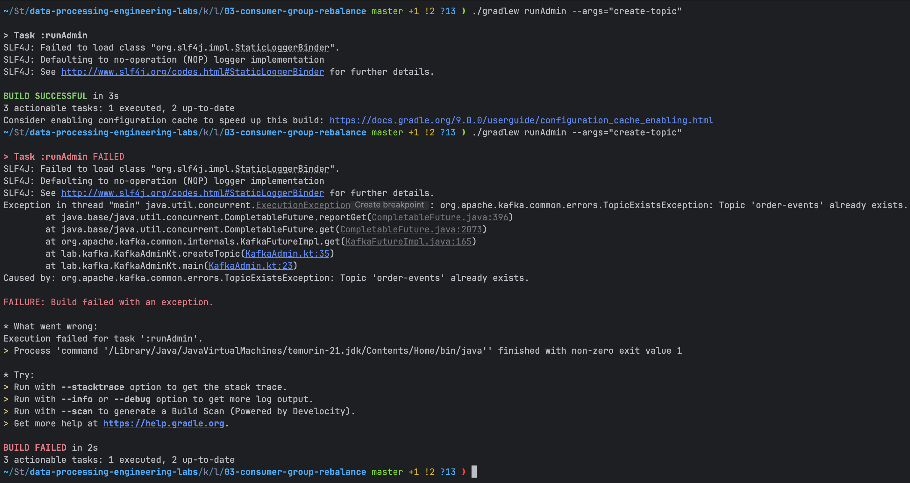

AdminClient와 Kafka CLI 모두 `order-events`의 Partition 수를 6개, Replication Factor를 1로 조회했다.

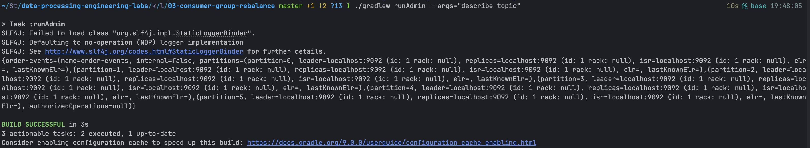

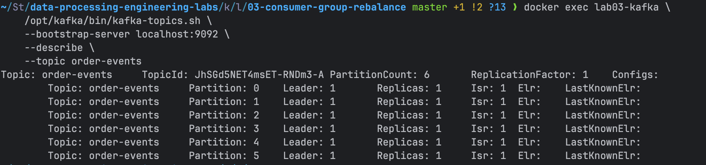

Producer가 `orderId`를 Key로 사용해 주문 이벤트 100건을 전송했다.

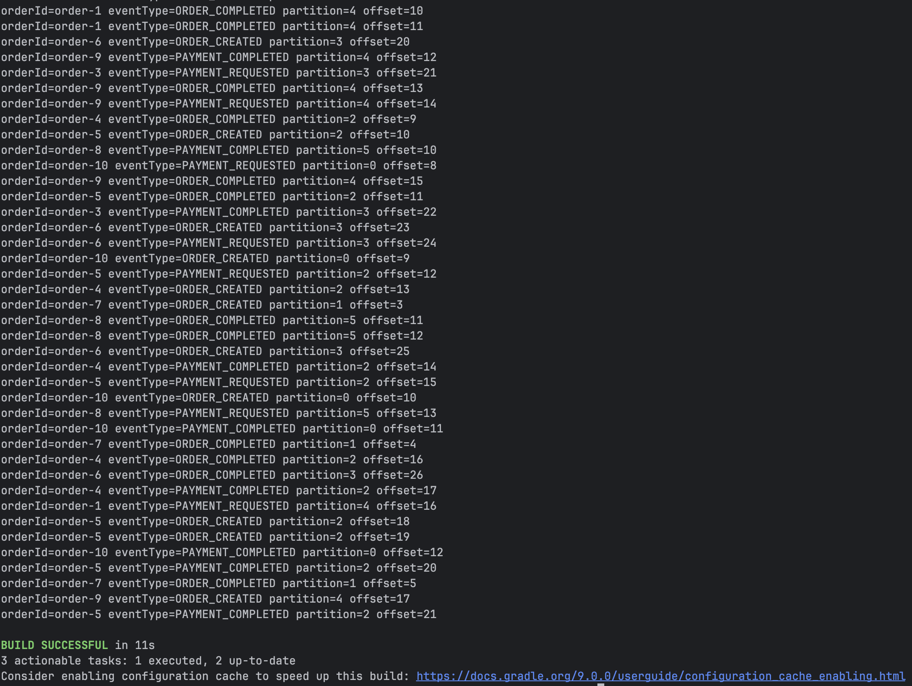

단일 Consumer가 Partition 0부터 5까지의 Record를 처리했다. 각 Partition의 Offset은 서로 독립적으로 증가했다.

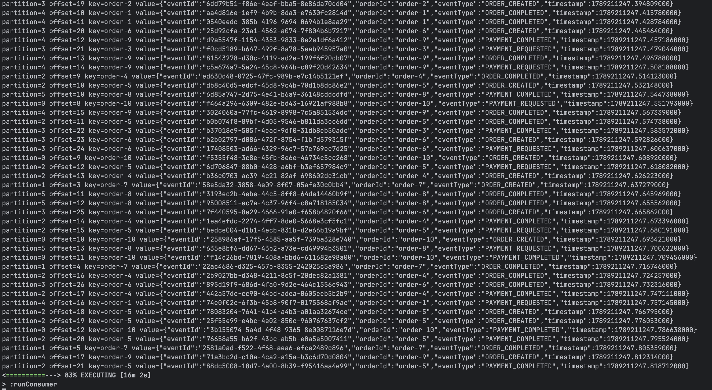

AdminClient 조회에서 Group은 `Stable`, Assignor는 `range`, Group Type은 `Classic`으로 나타났다. 단일 Member에는 Partition 0부터 5까지 할당되었다.

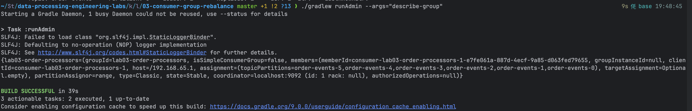

Kafka CLI에서도 동일한 Member 한 개와 Partition 6개의 Assignment `(0,1,2,3,4,5)`를 확인했다.

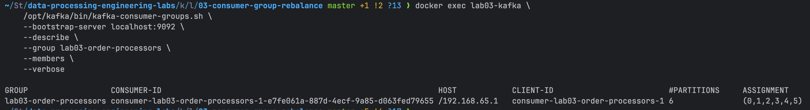

### 결과

| Consumer 수 | Group 상태 | Assignor | Assigned Partitions | 처리 Record 수 |
|---:|---|---|---|---:|
| 1 | Stable | range | 0, 1, 2, 3, 4, 5 | 100 |

| 검증 항목 | AdminClient | Kafka CLI | 비교 결과 |
|---|---|---|---|
| Topic Partition 수 | 6 | 6 | 일치 |
| Replication Factor | 1 | 1 | 일치 |
| Consumer 수 | 1 | 1 | 일치 |
| Assigned Partition 수 | 6 | 6 | 일치 |
| Assignment | 0, 1, 2, 3, 4, 5 | 0, 1, 2, 3, 4, 5 | 일치 |

단일 Consumer가 6개 Partition을 모두 할당받아 처리했다. Producer가 생성한 100건은 Partition별로 분산되었고, 단일 Consumer가 모든 Partition의 Record를 처리했다.

### 해석 및 궁금증

- 컨슈머 그룹의 병렬 처리 단위는 컨슈머가 아니라 파티션이다. 그룹에 멤버가 하나뿐이므로 구독 대상인 파티션 6개를 해당 컨슈머가 모두 할당받았다.
- 캡처에서 Partition별 Offset은 각각 증가하지만 서로 다른 Partition의 Record는 섞여 출력된다. 따라서 하나의 Consumer가 모든 Partition을 처리하더라도 Topic 전체 순서는 보장되지 않고 Partition 내부 순서만 관찰할 수 있다.
- AdminClient와 Kafka CLI의 결과는 이번 조회에서 일치했다.

## Experiment 2. Scale Consumers from One to Three

### 목적

- 같은 컨슈머 그룹의 컨슈머를 1개에서 2개, 3개로 늘릴 때 파티션이 어떻게 재할당되는지 확인한다.
- 컨슈머 증설 전후에 모든 컨슈머 로그에서 레코드 출력이 끊긴 간격을 관찰하고, 이 값이 리밸런싱 자체의 소요 시간과 다른 이유를 확인한다.
- 각 컨슈머를 구분하고 할당·반납된 파티션을 확인할 수 있도록 기본 컨슈머를 확장한다.
- 컨슈머를 늘리는 동안에도 레코드가 계속 들어오도록 프로듀서 실행 방식을 확장한다.

### 명령어

2번의 독립된 실험으로 나누어 실험했다.

첫 번째 실험에서는 c1에 파티션이 할당된 상태를 확인한 뒤 c2를 합류시키고, AdminClient로 멤버가 2개인 상태를 조회했다. 이 실험에서는 레코드가 계속 들어오지 않았으므로 처리 시간은 계산하지 않았다.

```bash
docker compose down
docker compose up -d
# Ex3 변경 반영
./gradlew runAdmin --args="create-topic 6"

./gradlew runConsumer --args="c1"
./gradlew runConsumer --args="c2"
./gradlew runAdmin --args="describe-group"
```

첫 번째 실험을 종료한 뒤 Kafka와 토픽을 다시 초기화했다. 두 번째 실험에서는 프로듀서를 `continuous` 모드로 실행해 100ms 간격으로 레코드를 보냈다. 이 상태에서 c1부터 다시 시작해 c2와 c3을 순서대로 합류시켰다.

```bash
docker compose down
docker compose up -d
# Ex3 변경 반영
./gradlew runAdmin --args="create-topic 6"

./gradlew runConsumer --args="c1"
./gradlew runProducer --args="continuous"
./gradlew runConsumer --args="c2"
./gradlew runConsumer --args="c3"
```

### 실제 출력

#### 첫 번째 실험: 파티션 할당 확인

첫 번째 실험에서 c1은 파티션 0~5를 모두 할당받았다.

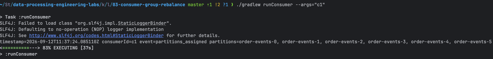

c2가 합류하자 c1은 기존 파티션 6개를 모두 반납한 뒤 파티션 0, 1, 2를 다시 할당받았다.

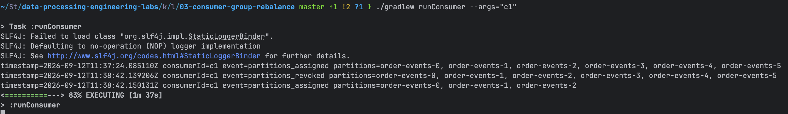

c2는 파티션 3, 4, 5를 할당받았다.

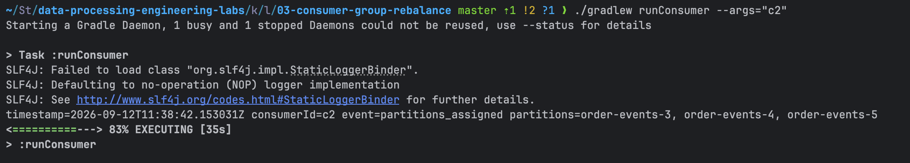

첫 번째 실험의 AdminClient 조회에서도 c1은 파티션 0~2, c2는 파티션 3~5를 소유한 것으로 확인되었다.

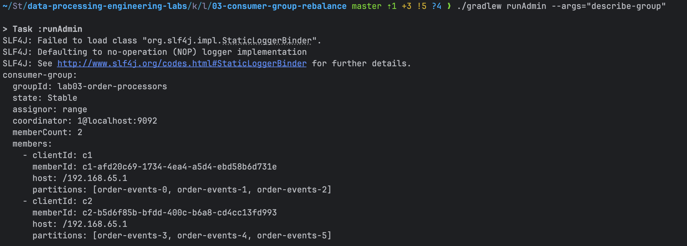

#### 두 번째 실험: 레코드가 유입되는 동안 컨슈머 증설

두 번째 실험은 Kafka와 토픽을 다시 초기화하고 c1부터 시작했다. 프로듀서가 `continuous` 모드로 실행되는 동안 c2가 합류하자 c1은 파티션 6개를 모두 반납한 뒤 파티션 0, 1, 2를 다시 할당받았다.

리밸런싱 직전 전체 로그의 마지막 레코드와 리밸런싱 이후 처음 출력된 레코드 사이에는 약 136ms의 간격이 있었다.

이 값은 리밸런싱 자체의 소요 시간이 아니다. 프로듀서의 100ms 전송 주기, 키에 따른 파티션 분포, 레코드를 가져오는 시간과 애플리케이션 출력 시간이 모두 포함되어 있다.

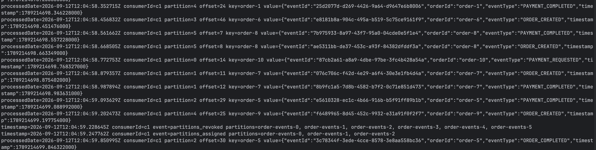

c2는 파티션 3, 4, 5를 할당받아 레코드 처리를 시작했다.

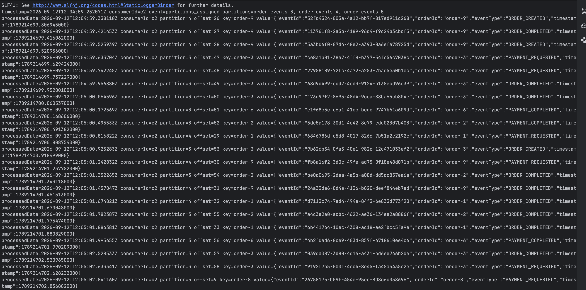

c3가 합류하자 c1은 파티션 0~2를 반납한 뒤 파티션 0, 1을 할당받았다.

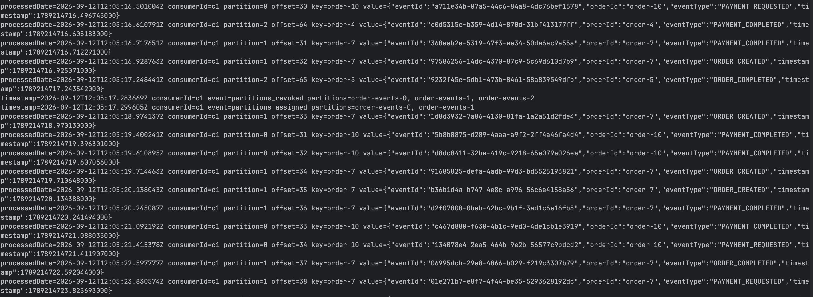

c2는 파티션 3~5를 반납한 뒤 파티션 2, 3을 할당받았다.

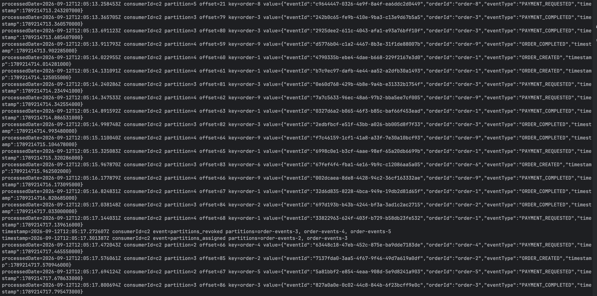

c3는 파티션 4, 5를 할당받고 레코드 처리를 시작했다. 멤버가 3개인 최종 상태는 세 컨슈머의 콜백 로그로 확인했으며 따로 브로커에 컨슈머 그룹 상태를 조회하지 않았다.

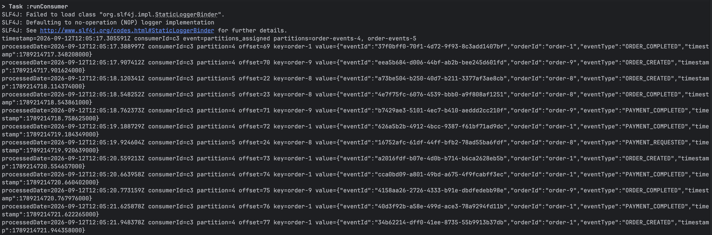

### 결과

| 실행 | 컨슈머 수 | c1 파티션 | c2 파티션 | c3 파티션 | 소유자가 바뀐 파티션 수 | 전체 컨슈머의 레코드 출력 공백 |
|---|---:|---|---|---|---:|---:|
| 첫 번째: 할당 확인 | 1 | 0, 1, 2, 3, 4, 5 | - | - | 0 | 측정하지 않음 |
| 첫 번째: 할당 확인 | 2 | 0, 1, 2 | 3, 4, 5 | - | 3 | 측정하지 않음 |
| 두 번째: 지속 처리 | 1 | 0, 1, 2, 3, 4, 5 | - | - | 0 | - |
| 두 번째: 지속 처리 | 2 | 0, 1, 2 | 3, 4, 5 | - | 3 | 약 136ms |
| 두 번째: 지속 처리 | 3 | 0, 1 | 2, 3 | 4, 5 | 3 | 약 141ms |

전체 컨슈머의 레코드 출력 공백은 같은 `group.id`에 속한 모든 컨슈머의 로그를 하나의 시간축으로 합친 뒤, 리밸런싱 직전 마지막 `processedDate`와 리밸런싱 후 가장 빠른 `processedDate`의 차이로 계산했다. c2 합류 시에는 `12:04:59.202473Z`부터 `12:04:59.338110Z`까지 약 136ms, c3 합류 시에는 `12:05:17.248441Z`부터 `12:05:17.388997Z`까지 약 141ms다.

c2 합류 시에는 다음 시간축도 별도로 확인했다.

| 관찰 지점 | 시각 | 이전 지점과의 간격 |
|---|---|---:|
| c1의 리밸런싱 전 마지막 레코드 처리 | `12:04:59.202473Z` | - |
| c1의 `partitions_revoked` 콜백 | `12:04:59.228645Z` | 약 26ms |
| c1의 `partitions_assigned` 콜백 | `12:04:59.247762Z` | 약 19ms |
| c2의 `partitions_assigned` 콜백 | `12:04:59.250071Z` | - |
| c2의 첫 레코드 처리 | `12:04:59.338110Z` | c2 할당 후 약 88ms |
| c1의 첫 레코드 처리 | `12:04:59.850995Z` | c1 할당 후 약 603ms |

c1만 보면 마지막 레코드부터 다음 레코드까지 약 649ms의 간격이 있다. 그러나 c1이 다음에 처리한 이벤트의 생성 시각도 약 `12:04:59.846Z`이므로, c1이 할당 후 기존 레코드를 약 603ms 동안 처리하지 못했다고 볼 근거는 없다. c1이 소유한 파티션 0, 1, 2로 다음 레코드가 들어올 때까지 기다린 시간이 대부분 포함된 것으로 해석한다.

따라서 약 136ms는 모든 컨슈머의 로그를 합쳤을 때 관찰된 두 레코드 출력 사이의 간격이고, 약 649ms는 c1에서 레코드가 출력된 간격이다. 약 19ms도 c1의 파티션 반납 콜백과 할당 콜백 사이의 간격일 뿐 리밸런싱 전체 소요 시간은 아니다. 현재 로그만으로 리밸런싱 자체의 소요 시간을 따로 계산할 수는 없다.

### 해석 및 궁금증

- 같은 컨슈머 그룹의 컨슈머들은 동일한 레코드를 함께 처리하지 않고 파티션을 나누어 맡는다. 그룹 상태가 안정되면 하나의 파티션은 한 멤버에게만 할당되므로 컨슈머를 늘리는 과정에서 일부 파티션의 소유자가 바뀌었다.
- 파티션 6개는 컨슈머가 2개일 때 3개씩, 3개일 때 2개씩 균등하게 나뉘었다. 파티션 수가 컨슈머 수로 나누어떨어지지 않으면 완전히 균등하게 나눌 수 없다.
- Range Assignor의 eager 리밸런싱에서는 c1과 c2가 나중에도 유지할 파티션까지 일단 모두 반납한 후 다시 할당받았다. 실제 소유자가 바뀐 파티션은 컨슈머를 늘릴 때마다 3개였지만 `partitions_revoked` 콜백에는 그보다 많은 파티션이 포함되었다.
- c2 합류 시 c1의 레코드 출력 간격은 약 649ms였지만 모든 컨슈머의 로그에서 레코드 출력이 끊긴 간격은 약 136ms였다. c1의 다음 레코드 자체가 늦게 생성되었으므로 두 값의 차이를 c1의 리밸런싱 지연으로 해석하지 않는다.
- 어떤 조건이 리밸런싱과 처리 재개를 늦추는지는 이번 실험만으로 알 수 없다. 후속 실험에서 종료 방식, 타임아웃, 컨슈머와 파티션 수, 파티션 할당 전략, 리밸런싱 콜백의 작업 시간과 코디네이터까지의 네트워크 지연을 하나씩 바꾸며 비교해 보면 좋을 것 같다.

## Experiment 3. Run More Consumers Than Partitions

### 목적

- 같은 컨슈머 그룹의 컨슈머를 파티션 수보다 하나 많게 되었을 때 각 컨슈머의 파티션 할당을 확인한다.
- 파티션을 할당받지 못한 컨슈머가 레코드를 처리하는지 확인한다.
- 컨슈머 수가 파티션 수를 초과한 뒤에도 처리에 참여하는 컨슈머 수가 늘어나는지 확인한다.

### 명령어

이전 실험의 프로세스와 데이터를 정리한 뒤 Kafka를 다시 시작한다. `application.yml`의 기본값은 변경하지 않고 `create-topic`의 인자로 파티션 수 3을 지정한다.

```bash
docker compose down
docker compose up -d
./gradlew runAdmin --args="create-topic 3"
```

서로 다른 Terminal에서 같은 `group.id`를 사용하는 컨슈머 4개를 순서대로 실행한다. 각 컨슈머의 할당 로그를 확인한 뒤 다음 컨슈머를 실행한다.

```bash
# Terminal 1
./gradlew runConsumer --args="c1"

# Terminal 2
./gradlew runConsumer --args="c2"

# Terminal 3
./gradlew runConsumer --args="c3"

# Terminal 4
./gradlew runConsumer --args="c4"
```

다른 Terminal에서 레코드가 계속 유입되도록 프로듀서를 실행한다.

```bash
# Terminal 5
./gradlew runProducer --args="continuous"
```

컨슈머 그룹이 안정된 뒤 AdminClient와 Kafka CLI로 모든 멤버의 할당을 각각 조회한다.

```bash
./gradlew runAdmin --args="describe-group"
```

### 실제 출력

프로듀서는 파티션 0, 1, 2에 레코드를 전송했다.

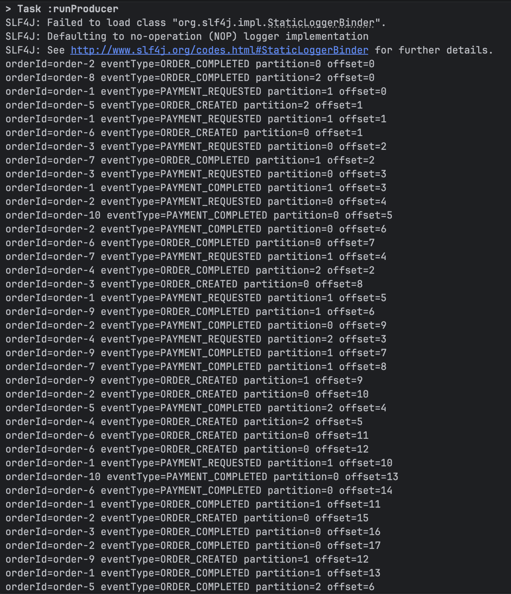

c1은 처음에 파티션 0, 1, 2를 모두 할당받았다. c2와 c3가 합류하면서 담당 파티션이 줄었고, c4 합류 후에도 파티션 0을 다시 할당받아 레코드를 처리했다.

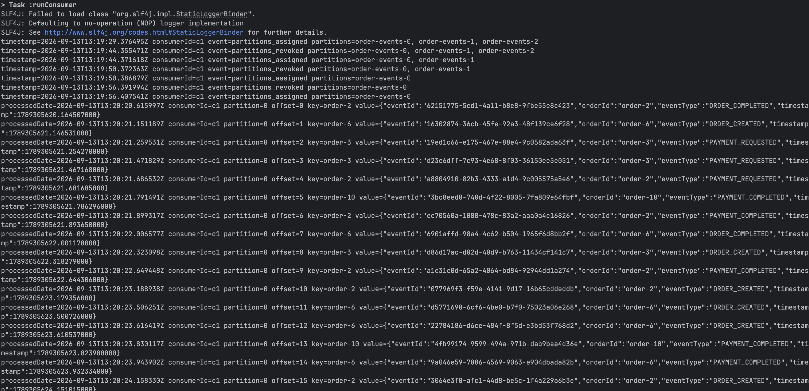

c2는 처음에 파티션 2를 할당받았고 c3 합류 후 파티션 1로 변경되었다. c4가 합류할 때 파티션 1을 반납한 뒤 같은 파티션을 다시 할당받아 레코드를 처리했다.

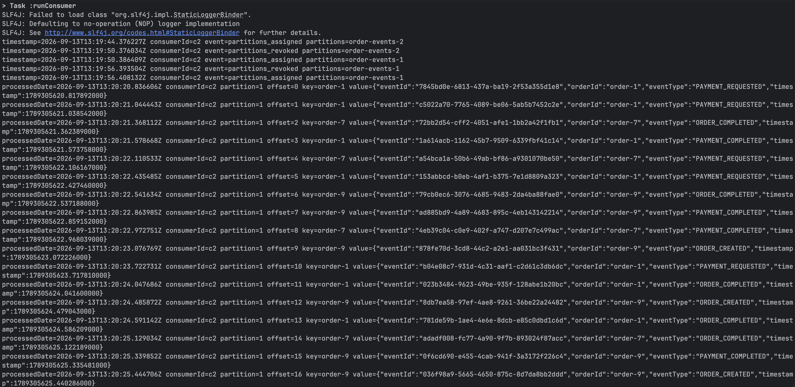

c3는 파티션 2를 할당받았다. c4가 합류할 때 파티션 2를 반납한 뒤 같은 파티션을 다시 할당받아 레코드를 처리했다.

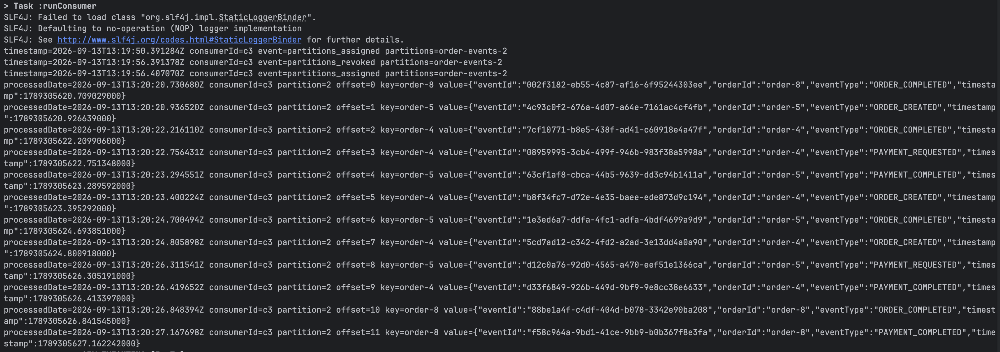

c4는 컨슈머 그룹에 합류했지만 `partitions_assigned`의 파티션 목록이 비어 있었다. 프로세스는 종료되지 않고 계속 실행 중이었으며, 캡처에는 레코드 처리 로그가 출력되지 않았다.

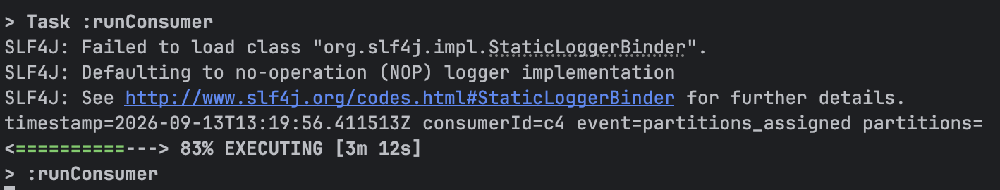

AdminClient 조회에서 컨슈머 그룹은 `Stable`, 파티션 할당 전략은 `range`, 멤버 수는 4로 나타났다. c1, c2, c3에는 각각 파티션 0, 1, 2가 할당되었고 c4의 파티션 목록은 비어 있었다.

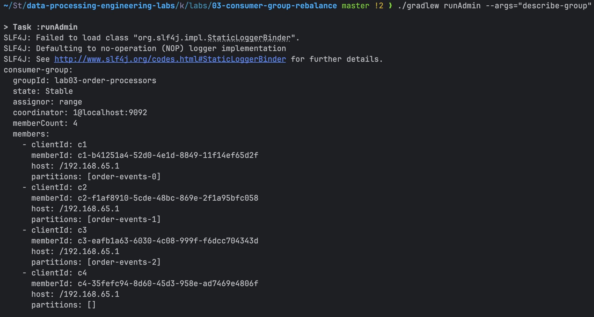

### 결과

컨슈머 그룹이 `Stable`인 AdminClient 조회 시점과 각 컨슈머 캡처를 기준으로 기록했다.

| 컨슈머 | 최종 할당 파티션 | 레코드 처리 로그 | 관찰 결과 |
|---|---|---|---|
| c1 | 0 | 있음 | 파티션 0 처리 |
| c2 | 1 | 있음 | 파티션 1 처리 |
| c3 | 2 | 있음 | 파티션 2 처리 |
| c4 | 없음 | 없음 | 프로세스는 실행 중이지만 처리에는 참여하지 않음 |

### 해석 및 궁금증

- 3개 파티션은 c1, c2, c3에 하나씩 할당되었고 네 번째로 합류한 c4에는 파티션이 할당되지 않았다. 컨슈머가 3개에서 4개로 늘어도 레코드 처리에 참여한 컨슈머 수는 3개로 유지되었다.
- c4는 파티션을 할당받지 못했지만 AdminClient에서 컨슈머 그룹의 멤버로 조회되었다. 따라서 파티션 할당이 비어 있다는 것과 컨슈머 그룹에 참여하지 않았다는 것은 다르다.
- c4 프로세스는 빈 파티션 할당을 받은 뒤에도 실행 중이었다. 다만 현재 로그에는 `poll()` 호출 자체를 기록하지 않으므로 `poll()`이 계속 호출되는지는 캡처만으로 확인할 수 없다.
- c4가 합류할 때 c1, c2, c3는 각각 담당하던 파티션을 반납한 뒤 같은 파티션을 다시 할당받았다. 최종 파티션 소유자는 바뀌지 않았지만 Range Assignor의 eager 리밸런싱은 발생했으므로, 파티션을 할당받지 못한 컨슈머를 추가하는 것도 비용이 없지는 않았다.

## Experiment 4. Graceful Close vs Abrupt Termination

### 목적

- 같은 조건에서 c2를 SIGTERM으로 정상 종료한 경우와 `kill -9`로 강제 종료한 경우를 각각 실행한다.
- 종료 대상인 c2에서 종료 요청, 파티션 반납과 `consumer.close()` 시작·완료를 구분해 기록한다.
- 남은 c1의 파티션 반납·할당 콜백 시각을 비교해 c2 종료부터 재할당까지 걸린 시간을 확인한다.
- 종료 전후의 컨슈머 그룹 멤버 수와 파티션 할당을 AdminClient로 확인한다.

### 명령어

먼저 컨슈머가 시작될 때 PID를 출력하고, SIGTERM을 받으면 `poll()`을 중단한 뒤 컨슈머 실행 스레드에서 `consumer.close()`를 호출하도록 구현한다. c2에서는 종료 요청, 파티션 반납과 `close()` 시작·완료 시각을, c1에서는 파티션 반납·할당 시각을 로그로 남긴다.

첫 번째 실행에서는 Kafka와 6개 파티션 토픽을 준비한다.

```bash
docker compose down
docker compose up -d
./gradlew runAdmin --args="create-topic 6"
```

서로 다른 터미널에서 c1, c2와 지속 프로듀서를 실행한다. 두 컨슈머의 최초 할당과 로그에 출력된 c2 PID를 확인한다.

```bash
# Terminal 1
./gradlew runConsumer --args="c1"

# Terminal 2
./gradlew runConsumer --args="c2"

# Terminal 3
./gradlew runProducer --args="continuous"
```

컨슈머 그룹이 `Stable`인 상태를 조회한 뒤 c2에 SIGTERM을 보내고, c1의 재할당이 끝난 상태를 다시 조회한다.

```bash
./gradlew runAdmin --args="describe-group"
kill -TERM <c2-pid>
./gradlew runAdmin --args="describe-group"
```

첫 번째 실행의 로그를 보존한 뒤 모든 프로세스와 Kafka를 종료한다. 두 번째 실행에서는 Kafka와 토픽을 다시 만들고 c1, c2와 지속 프로듀서를 같은 순서로 실행한다.

```bash
docker compose down
docker compose up -d
./gradlew runAdmin --args="create-topic 6"

./gradlew runConsumer --args="c1"
./gradlew runConsumer --args="c2"
./gradlew runProducer --args="continuous"
```

강제 종료 시각은 c2 내부에 남길 수 없으므로 외부 터미널에서 UTC 시각을 출력한 직후 c2에 SIGKILL을 보낸다. c1의 재할당이 끝나면 컨슈머 그룹을 다시 조회한다.

```bash
python3 -c 'from datetime import datetime, timezone; print(datetime.now(timezone.utc).isoformat())' \
  && kill -9 <c2-pid>
./gradlew runAdmin --args="describe-group"
```

### 실제 출력

SIGTERM 실행에서 c1은 처음 6개 파티션을 모두 할당받았고, c2가 합류한 뒤 파티션 0, 1, 2를 할당받았다.

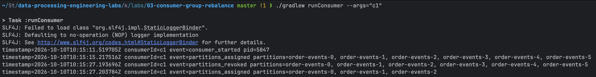

c2는 PID 5877로 시작했고 파티션 3, 4, 5를 할당받았다.

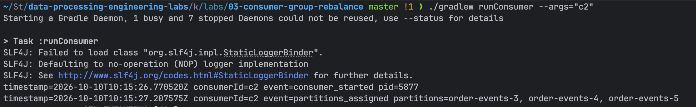

종료 전 AdminClient 조회에서 그룹은 `Stable`, 멤버 수는 2였으며 c1과 c2가 파티션을 3개씩 나누어 가지고 있었다.

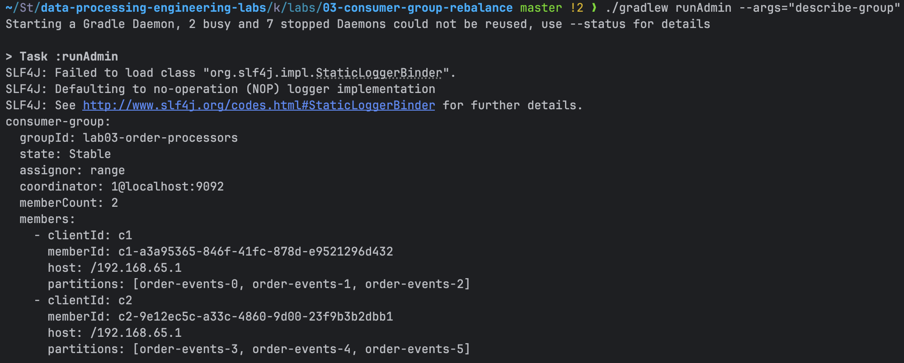

c2는 SIGTERM 이후 종료 요청을 기록하고 `consumer.close()`를 시작했다. 파티션 3, 4, 5의 반납 콜백이 호출된 뒤 0.165994초 만에 Close가 완료되었다. Gradle은 시그널로 종료된 JavaExec 프로세스를 작업 실패로 표시했다.

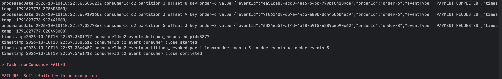

c1은 파티션 0, 1, 2를 반납한 뒤 6개 파티션을 모두 다시 할당받았다. 캡처에는 리밸런싱 전 마지막 레코드와 리밸런싱 후 첫 레코드도 포함되어 있다.

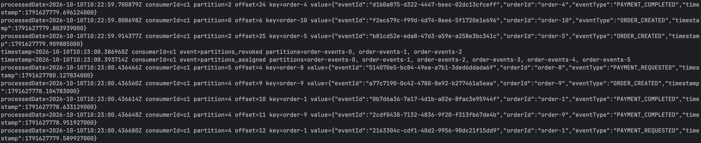

종료 후 AdminClient 조회에서 그룹은 `Stable`, 멤버 수는 1이었으며 c1이 6개 파티션을 모두 가지고 있었다.

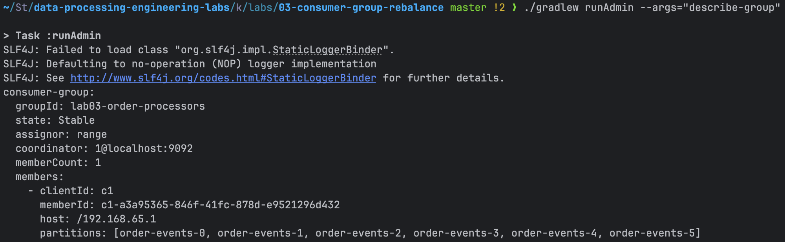

SIGKILL 실행에서는 외부 터미널에서 UTC 시각 `2026-10-10T11:37:12.495777+00:00`을 출력한 직후 PID 9247인 c2에 `kill -9`를 실행했다.

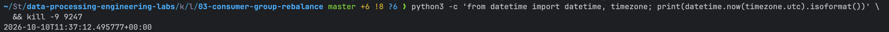

c2에서는 마지막 레코드 처리 로그 직후 프로세스가 exit code 137로 종료되었다. SIGTERM 실행에서 확인한 종료 요청, 파티션 반납과 Close 시작·완료 로그는 남지 않았다.

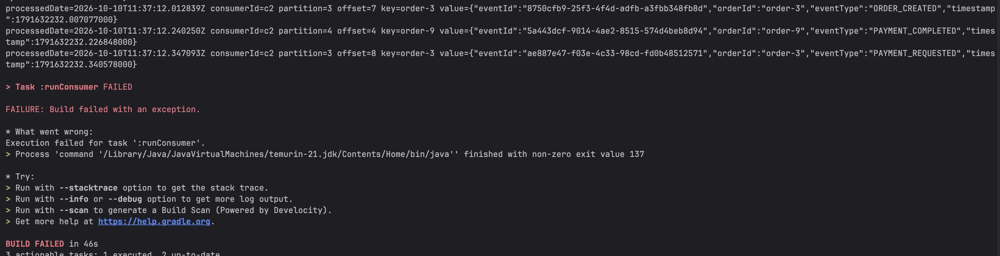

c1은 SIGKILL 시각으로부터 약 44초 뒤 파티션 0, 1, 2를 반납하고 6개 파티션을 모두 다시 할당받았다. 캡처에는 리밸런싱 전 마지막 레코드와 리밸런싱 후 첫 레코드도 포함되어 있다.

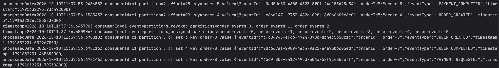

AdminClient 조회에서 종료 전에는 그룹이 `Stable`, 멤버 수가 2였고 c1과 c2가 파티션을 3개씩 나누어 가지고 있었다. 종료 후에는 그룹이 다시 `Stable`이 되었고, 남은 c1이 6개 파티션을 모두 가지고 있었다.

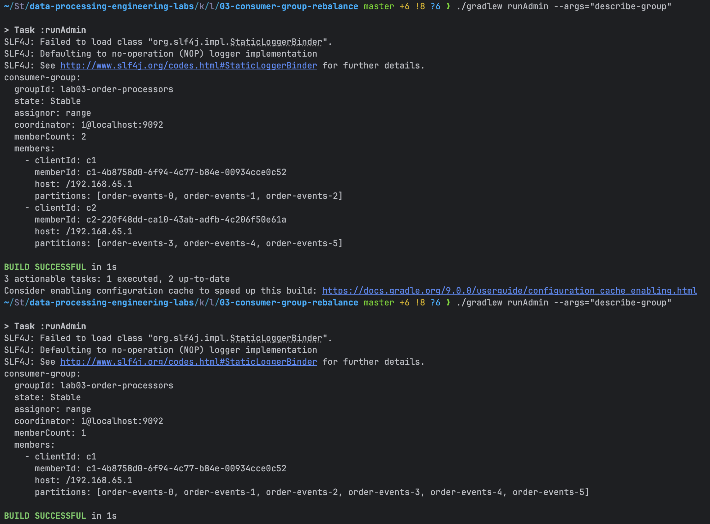

### 결과

SIGTERM의 종료 기준은 c2의 `shutdown_requested`, SIGKILL의 종료 기준은 외부 터미널에 기록할 UTC 시각으로 삼는다. 종료 시점은 두 실행 모두 c1의 `partitions_assigned`로 맞춘다.

| 종료 방식 | 종료 기준 시각 | c1 파티션 반납 시각 | c1 파티션 할당 시각 | 종료 기준→할당 간격 | c2에서 관찰한 마지막 이벤트 |
|---|---|---|---|---:|---|
| SIGTERM | 2026-10-10T10:22:57.380177Z | 2026-10-10T10:23:00.386960Z | 2026-10-10T10:23:00.393714Z | 3.013537초 | `consumer_close_completed` |
| SIGKILL | 2026-10-10T11:37:12.495777Z | 2026-10-10T11:37:56.643790Z | 2026-10-10T11:37:56.650906Z | 44.155129초 | `processedDate` 2026-10-10T11:37:12.347093Z, 종료 로그 없음 |

종료 전후 파티션 할당을 기록한다.

| 종료 방식 | 시점 | c1 할당 파티션 | c2 할당 파티션 | 그룹 멤버 수 | 그룹 상태 |
|---|---|---|---|---:|---|
| SIGTERM | 종료 전 | 0, 1, 2 | 3, 4, 5 | 2 | Stable |
| SIGTERM | 종료 후 | 0, 1, 2, 3, 4, 5 | - | 1 | Stable |
| SIGKILL | 종료 전 | 0, 1, 2 | 3, 4, 5 | 2 | Stable |
| SIGKILL | 종료 후 | 0, 1, 2, 3, 4, 5 | - | 1 | Stable |

c1의 레코드 로그에서 관찰한 출력 간격은 리밸런싱 시간과 분리해 기록한다.

| 종료 방식 | 리밸런싱 전 마지막 처리 시각 | 리밸런싱 후 첫 처리 시각 | 레코드 출력 간격 |
|---|---|---|---:|
| SIGTERM | 2026-10-10T10:22:59.914377Z | 2026-10-10T10:23:00.436466Z | 0.522089초 |
| SIGKILL | 2026-10-10T11:37:56.158343Z | 2026-10-10T11:37:56.678010Z | 0.519667초 |

### 해석 및 궁금증

- SIGTERM에서는 c2가 `consumer.close()`를 실행하면서 파티션 반납과 Close 완료를 기록했고, 약 3.014초 뒤 c1의 재할당이 완료되었다. SIGKILL에서는 c2의 종료 로그 없이 프로세스가 끝났고, 기본 세션 타임아웃 45초에 가까운 약 44.155초 뒤 c1의 재할당이 완료되었다.
- 이외의 작업은 차이가 없었던 것으로 확인된다.

## Experiment 5. Heartbeat, Session Timeout and Network Failure

### 목적

- `heartbeat.interval.ms`를 2초로 고정하고 `session.timeout.ms`를 6초와 15초로 바꿔 c2를 SIGKILL로 종료한다.
- 장애 주입부터 남은 c1이 파티션 반납과 재할당을 관찰할 때까지 걸린 시간을 구분해 측정한다.
- Heartbeat 주기와 Session Timeout이 장애 감지 과정에서 서로 다른 역할을 하는지 확인한다.
- 후속 실행에서 Network 단절을 같은 기준으로 비교한다.

### 명령어

첫 번째 실행에서는 Consumer 설정에 Heartbeat 2초와 Session Timeout 6초를 적용했다.

```yaml
kafka:
  consumer:
    heartbeat-interval-ms: 2000
    session-timeout-ms: 6000
```

Kafka와 6개 파티션 토픽을 준비했다.

```bash
docker compose down
docker compose up -d
./gradlew runAdmin --args="create-topic 6"
```

서로 다른 터미널에서 c1, c2와 지속 프로듀서를 실행했다.

```bash
# Terminal 1
./gradlew runConsumer --args="c1"

# Terminal 2
./gradlew runConsumer --args="c2"

# Terminal 3
./gradlew runProducer --args="continuous"
```

두 컨슈머의 파티션 할당이 끝난 뒤 컨슈머 그룹이 `Stable`인지 확인했다.

```bash
./gradlew runAdmin --args="describe-group"
```

외부 터미널에서 UTC 시각을 출력한 직후 c2의 Java Process에 SIGKILL을 보냈다. c1의 재할당이 끝난 뒤 컨슈머 그룹을 다시 조회했다.

```bash
python3 -c 'from datetime import datetime, timezone; print(datetime.now(timezone.utc).isoformat())' \
  && kill -9 83365

./gradlew runAdmin --args="describe-group"
```

첫 번째 실행의 로그를 보존한 뒤 모든 프로세스와 Kafka를 종료했다. 두 번째 실행에서는 Heartbeat를 2초로 유지하고 Session Timeout만 15초로 변경했다.

```yaml
kafka:
  consumer:
    heartbeat-interval-ms: 2000
    session-timeout-ms: 15000
```

Kafka와 토픽을 다시 만들고 c1, c2와 지속 프로듀서를 같은 순서로 실행했다. 컨슈머 그룹이 `Stable`이고 멤버가 2개인 상태를 확인한 뒤 c2에 SIGKILL을 보냈다.

```bash
docker compose down
docker compose up -d
./gradlew runAdmin --args="create-topic 6"

./gradlew runConsumer --args="c1"
./gradlew runConsumer --args="c2"
./gradlew runProducer --args="continuous"

./gradlew runAdmin --args="describe-group"

python3 -c 'from datetime import datetime, timezone; print(datetime.now(timezone.utc).isoformat())' \
  && kill -9 84579

./gradlew runAdmin --args="describe-group"
```

Toxiproxy는 클라이언트와 서버 사이에서 TCP 연결을 전달하면서 연결 차단, 지연과 대역폭 제한 같은 Network 장애를 주입하는 도구다. Kafka 구성 요소는 아니며 이번 Lab에서 c2의 연결만 선택적으로 끊기 위한 실험 도구로 사용한다.

Kafka 컨테이너나 공통 Docker Network를 중단하면 c1, Producer와 AdminClient도 함께 영향을 받는다. c2 프로세스를 실행한 상태로 유지하면서 c2와 Kafka 사이의 통신만 차단하기 위해 Kafka에 직접 연결하는 `DIRECT` listener와 Toxiproxy를 통과하는 `PROXY` listener를 분리했다. Toxiproxy의 제어 API와 c2 접속 포트는 호스트의 loopback interface에만 공개했다.

```yaml
services:
  kafka:
    ports:
      - "9092:9092"
    environment:
      KAFKA_LISTENERS: DIRECT://:9092,PROXY://:29093,CONTROLLER://:9093
      KAFKA_ADVERTISED_LISTENERS: DIRECT://localhost:9092,PROXY://localhost:29092
      KAFKA_CONTROLLER_LISTENER_NAMES: CONTROLLER
      KAFKA_INTER_BROKER_LISTENER_NAME: DIRECT
      KAFKA_LISTENER_SECURITY_PROTOCOL_MAP: CONTROLLER:PLAINTEXT,DIRECT:PLAINTEXT,PROXY:PLAINTEXT

  toxiproxy:
    image: ghcr.io/shopify/toxiproxy:2.13.0
    ports:
      - "127.0.0.1:8474:8474"
      - "127.0.0.1:29092:29092"
    depends_on:
      - kafka
```

두 컨슈머의 연결 경로는 다음과 같이 분리한다.

```text
c1 -> localhost:9092 -> Kafka DIRECT listener
c2 -> localhost:29092 -> Toxiproxy -> kafka:29093 -> Kafka PROXY listener
```

Network 단절 실행 전 Compose 설정을 검증하고, Toxiproxy에 c2 전용 proxy를 생성한다. `listen`은 c2가 접속하는 Toxiproxy 포트이고 `upstream`은 Docker Network 안에서 Toxiproxy가 접속하는 Kafka service와 포트다.

```bash
docker compose config
docker compose down
docker compose up -d

curl -fsS \
  -X POST \
  -H 'Content-Type: application/json' \
  -d '{
    "name": "kafka-c2",
    "listen": "0.0.0.0:29092",
    "upstream": "kafka:29093",
    "enabled": true
  }' \
  http://localhost:8474/proxies

curl -fsS http://localhost:8474/proxies/kafka-c2
./gradlew runAdmin --args="create-topic 6"
```

c1은 기존 Kafka Port에 직접 연결하고 c2만 Toxiproxy Port를 Bootstrap Server로 사용한다. Producer와 AdminClient도 기존 직접 연결을 유지한다.

```bash
# Terminal 1
./gradlew runConsumer --args="c1"

# Terminal 2
./gradlew runConsumer --args="c2 localhost:29092"

# Terminal 3
./gradlew runProducer --args="continuous"

# 별도 Terminal
./gradlew runAdmin --args="describe-group"
```

Network 단절 시각을 기록한 뒤 c2 전용 proxy만 비활성화한다. c1이 6개 파티션을 다시 할당받은 것을 확인할 때까지 proxy를 비활성화한 상태로 유지한다.

```bash
python3 -c 'from datetime import datetime, timezone; print(datetime.now(timezone.utc).isoformat())' \
  && curl -fsS \
    -X PATCH \
    -H 'Content-Type: application/json' \
    -d '{"enabled":false}' \
    http://localhost:8474/proxies/kafka-c2

curl -fsS http://localhost:8474/proxies/kafka-c2
ps -p <c2-java-pid> -o pid=,stat=,command=
./gradlew runAdmin --args="describe-group"
```

c1의 재할당 결과를 보존한 뒤 proxy를 다시 활성화한다. c2가 재가입한 뒤 컨슈머 그룹을 다시 조회한다.

```bash
python3 -c 'from datetime import datetime, timezone; print(datetime.now(timezone.utc).isoformat())' \
  && curl -fsS \
    -X PATCH \
    -H 'Content-Type: application/json' \
    -d '{"enabled":true}' \
    http://localhost:8474/proxies/kafka-c2

./gradlew runAdmin --args="describe-group"
```

### 실제 출력

외부 터미널에 UTC 시각 `2026-10-24T11:18:58.449321+00:00`을 기록한 직후 PID 83365인 c2에 SIGKILL을 보냈다.

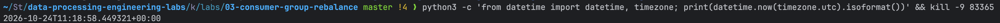

c1은 장애 주입 시각으로부터 약 6.890초 뒤 기존 파티션 0, 1, 2를 반납했다. 약 9ms 뒤 파티션 0부터 5까지를 모두 다시 할당받았다.

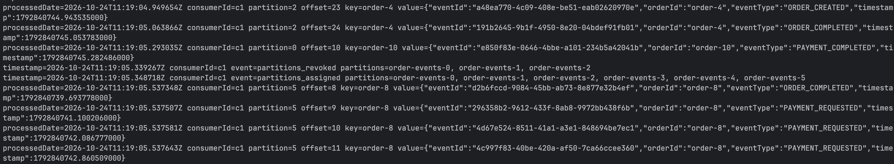

재할당 후 AdminClient 조회에서 컨슈머 그룹은 `Stable`, 멤버 수는 1이었으며 c1이 파티션 0부터 5까지 모두 소유했다.

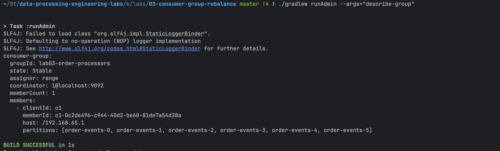

Session Timeout 15초 실행에서 장애 주입 전 컨슈머 그룹은 `Stable`이었고, c1은 파티션 0, 1, 2를, c2는 파티션 3, 4, 5를 소유했다.

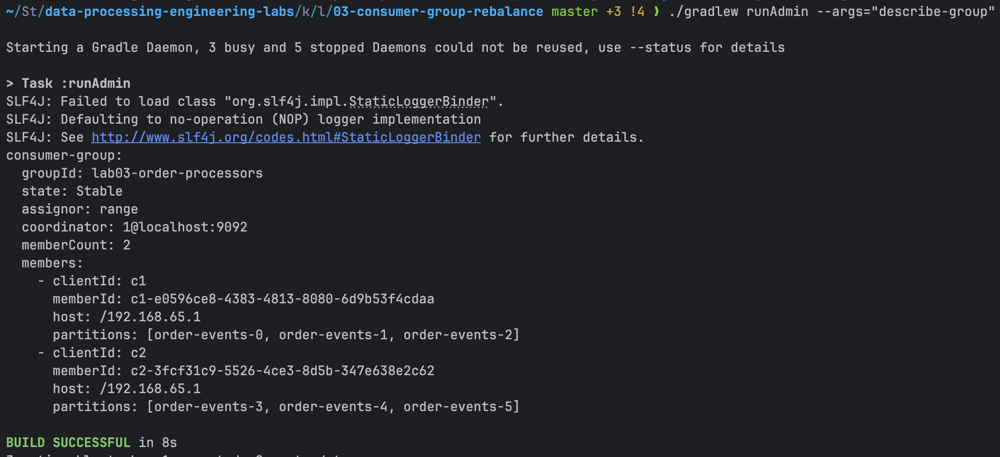

외부 터미널에 UTC 시각 `2026-10-24T11:31:54.631760+00:00`을 기록한 직후 PID 84579인 c2에 SIGKILL을 보냈다.

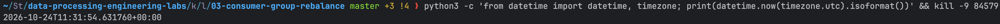

c1은 장애 주입 시각으로부터 약 14.072초 뒤 기존 파티션 0, 1, 2를 반납했다. 약 9ms 뒤 파티션 0부터 5까지를 모두 다시 할당받았다.

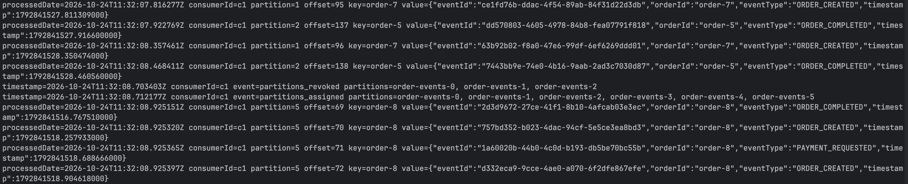

재할당 후 AdminClient 조회에서 컨슈머 그룹은 다시 `Stable`이 되었고, 남은 c1이 파티션 6개를 모두 소유했다.

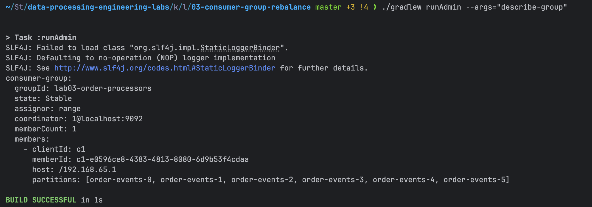

Network 단절 실행에서는 `kafka-c2` proxy가 `localhost:29092`에서 요청을 받고 Kafka의 `kafka:29093`으로 전달하도록 생성했다. 생성 결과에서 proxy는 `enabled=true`였다.

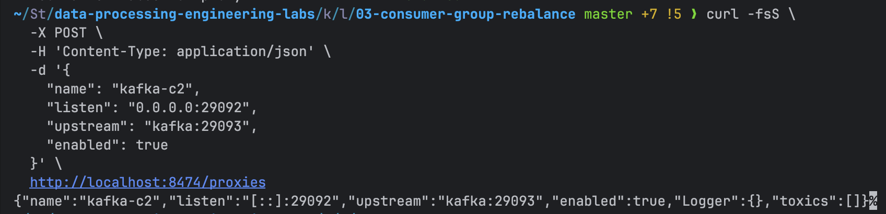

c1은 PID 86127로 시작해 `localhost:9092`에 직접 연결했고, Heartbeat 2초와 Session Timeout 6초를 적용했다. c2 합류 전에는 파티션 6개를 모두 소유했고 합류 후에는 파티션 0, 1, 2를 할당받았다.

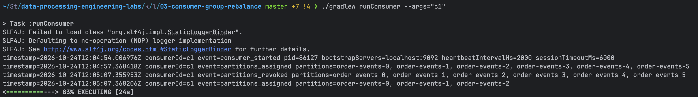

c2는 PID 86155로 시작해 `localhost:29092`의 Toxiproxy를 통과했고, 같은 Heartbeat와 Session Timeout을 적용했다. c2는 파티션 3, 4, 5를 할당받았다.

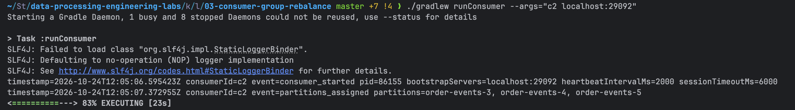

장애 주입 전 AdminClient 조회에서 컨슈머 그룹은 `Stable`, 멤버 수는 2였으며 c1과 c2가 파티션을 3개씩 소유했다. c1은 호스트에서 직접 접속해 `/192.168.65.1`로, c2는 Toxiproxy 컨테이너를 통해 접속해 `/172.18.0.3`으로 조회되었다.

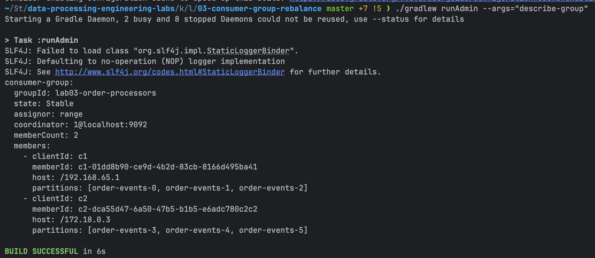

UTC 시각 `2026-10-24T12:07:33.975166+00:00`을 기록한 직후 `kafka-c2` proxy를 비활성화했다. 조회 결과는 `enabled=false`였지만 PID 86155인 c2 Java 프로세스는 `S` 상태로 계속 실행 중이었다. 직후 AdminClient 조회에서는 그룹이 `PreparingRebalance`, 멤버 수가 1로 나타났으며 c1의 파티션은 아직 비어 있었다.

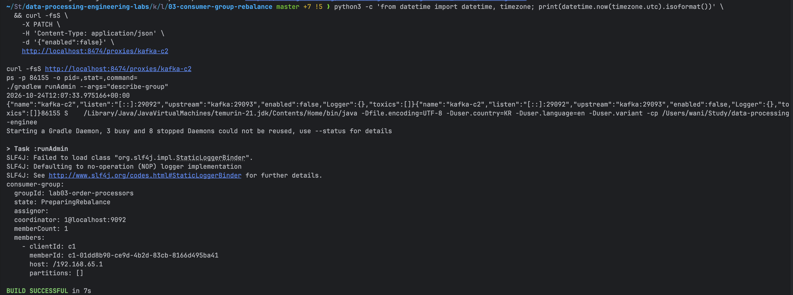

c1은 Network 단절 시각으로부터 약 7.494초 뒤 파티션 0, 1, 2를 반납했고 약 8ms 뒤 파티션 0부터 5까지를 모두 다시 할당받았다.

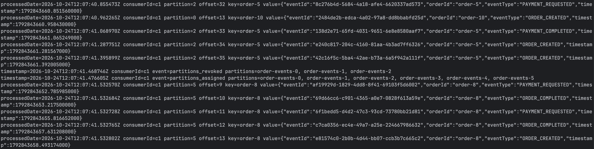

UTC 시각 `2026-10-24T12:12:09.922127+00:00`을 기록한 직후 proxy를 다시 활성화했다. 이후 AdminClient 조회에서 그룹은 `Stable`, 멤버 수는 2였으며 c1은 파티션 0, 1, 2를, c2는 파티션 3, 4, 5를 다시 소유했다.

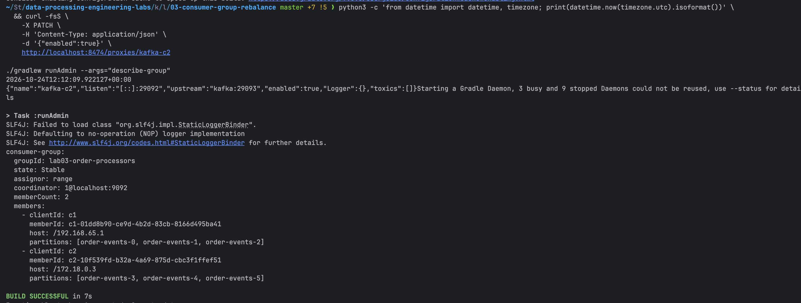

c1에서도 c2 재가입으로 파티션 6개를 반납한 뒤 파티션 0, 1, 2를 다시 할당받는 두 번째 리밸런싱을 확인했다.

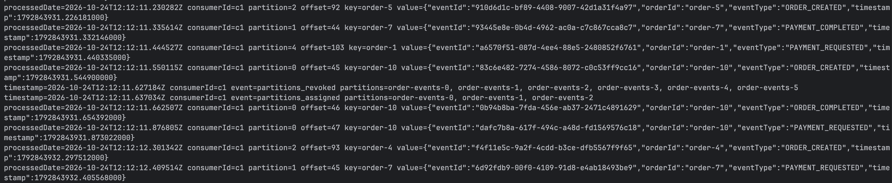

### 결과

먼저 핵심 비교만 요약한다.

| 확인한 질문 | 관찰 결과 | 이번 실행에서 내릴 수 있는 판단 |
|---|---|---|
| Session Timeout을 늘리면 감지가 늦어지는가? | SIGKILL 전체 재할당이 6초 설정에서 6.899초, 15초 설정에서 14.080초였다. | 같은 Heartbeat에서 Session Timeout이 길수록 재할당도 늦어졌다. |
| SIGKILL과 Network 단절의 감지 시간은 다른가? | 같은 6초 설정에서 각각 6.899초와 7.501초였다. | 한 번씩 측정한 0.602초 차이만으로 장애 종류의 영향이라고 판단할 수 없다. |
| Network가 복구되면 어떻게 되는가? | 복구 후 1.715초 안에 c1의 재할당이 끝나고 그룹이 다시 2명이 되었다. | 살아 있던 c2가 재가입하면서 두 번째 리밸런싱이 발생했다. |

장애 주입과 복구 시각은 외부 터미널에서 기록하고, 리밸런싱 시작과 완료는 c1의 콜백 시각으로 관찰했다.

| 기준 | 의미 |
|---|---|
| `T0` | c2에 SIGKILL을 보내거나 c2 전용 proxy를 비활성화한 시각 |
| `T1` | c1의 `partitions_revoked` 콜백 시각 |
| `T2` | c1의 `partitions_assigned` 콜백 시각 |
| `T3` | c2 전용 proxy를 다시 활성화한 시각 |
| `T4` | c2 재가입 후 c1의 `partitions_revoked` 콜백 시각 |
| `T5` | c2 재가입 후 c1의 `partitions_assigned` 콜백 시각 |

장애 조건별 핵심 측정값은 다음과 같다.

| 장애 조건 | Heartbeat | Session Timeout | c1에서 관찰한 장애 감지 `T1-T0` | 콜백에서 관찰한 재할당 `T2-T1` | 장애 주입부터 재할당 `T2-T0` | 장애 후 c2 프로세스 |
|---|---:|---:|---:|---:|---:|---|
| SIGKILL | 2000ms | 6000ms | 6.889946초 | 0.009451초 | 6.899397초 | 종료 |
| SIGKILL | 2000ms | 15000ms | 14.071643초 | 0.008774초 | 14.080417초 | 종료 |
| Network 단절 | 2000ms | 6000ms | 7.493580초 | 0.007859초 | 7.501439초 | 실행 중 |

원본 시각은 계산을 다시 검증할 수 있도록 별도로 남긴다.

| 장애 조건 | Session Timeout | T0: 장애 주입 | T1: 파티션 반납 | T2: 파티션 할당 |
|---|---:|---|---|---|
| SIGKILL | 6000ms | 2026-10-24T11:18:58.449321Z | 2026-10-24T11:19:05.339267Z | 2026-10-24T11:19:05.348718Z |
| SIGKILL | 15000ms | 2026-10-24T11:31:54.631760Z | 2026-10-24T11:32:08.703403Z | 2026-10-24T11:32:08.712177Z |
| Network 단절 | 6000ms | 2026-10-24T12:07:33.975166Z | 2026-10-24T12:07:41.468746Z | 2026-10-24T12:07:41.476605Z |

Network 단절과 복구 과정의 상태 변화는 다음과 같다.

| 시점 | Proxy | c2 프로세스 | 그룹 상태 | 멤버 수 | c1 파티션 | c2 파티션 |
|---|---|---|---|---:|---|---|
| 단절 전 | `enabled=true` | 실행 중 | Stable | 2 | 0, 1, 2 | 3, 4, 5 |
| 단절 직후 조회 | `enabled=false` | 실행 중 | PreparingRebalance | 1 | 할당 전 | - |
| Session 만료 후 c1 콜백 | `enabled=false` | 실행 중 | 조회하지 않음 | 조회하지 않음 | 0, 1, 2, 3, 4, 5 | - |
| Network 복구 후 | `enabled=true` | 실행 중 | Stable | 2 | 0, 1, 2 | 3, 4, 5 |

Network 복구부터 c2 재가입으로 발생한 두 번째 리밸런싱까지의 측정값은 다음과 같다.

| T3: Network 복구 | T4: c1 파티션 반납 | T5: c1 파티션 할당 | 재가입 관찰 `T4-T3` | 콜백에서 관찰한 재할당 `T5-T4` | 복구 후 재할당 `T5-T3` |
|---|---|---|---:|---:|---:|
| 2026-10-24T12:12:09.922127Z | 2026-10-24T12:12:11.627184Z | 2026-10-24T12:12:11.637034Z | 1.705057초 | 0.009850초 | 1.714907초 |

### 해석 및 궁금증

#### 설정값의 역할

| 설정 | 설정 주체 | 의미 | 이번 실험에서 확인한 점                                                         |
|---|---|---|-----------------------------------------------------------------------|
| `heartbeat.interval.ms` | 컨슈머 | 브로커에 생존 신호를 보내는 주기 | 2초마다 보내더라도 한 번 누락됐다고 바로 제거되지는 않았다.                                    |
| `session.timeout.ms` | 컨슈머 | 마지막으로 성공한 Heartbeat 이후 멤버 제거까지 허용하는 시간 | 6초에서 15초로 늘리자 장애 감지 관찰값도 약 6.890초에서 14.072초로 늘었다.                     |
| `group.min.session.timeout.ms` | 브로커 | 컨슈머가 요청할 수 있는 Session Timeout의 최솟값 | 이 값보다 작으면 브로커가 그룹 가입을 거부한다. 현재 구현에서는 `InvalidSessionTimeoutException`이 전파되어 컨슈머 애플리케이션이 종료된다. |

#### Session Timeout과 전체 복구 시간

- Heartbeat를 2초로 고정하고 Session Timeout만 6초에서 15초로 늘렸을 때 SIGKILL 후 전체 재할당 시간은 약 6.899초에서 14.080초로 증가했다.
- Experiment 4의 기본 Session Timeout 45초 조건에서는 같은 SIGKILL 후 약 44.155초가 걸렸다. 세 실행 모두 Session Timeout이 길수록 전체 재할당도 길어지는 방향을 보였다.
- 세 장애 실행에서 파티션 반납부터 재할당까지의 콜백 구간은 약 8~9ms였다. 전체 시간의 대부분은 파티션 할당 자체보다 Session 만료를 기다리는 구간에서 발생했다.

#### SIGKILL과 Network 단절

- 같은 Heartbeat 2초와 Session Timeout 6초에서 전체 재할당 시간은 SIGKILL 약 6.899초, Network 단절 약 7.501초였다.
- 차이는 약 0.602초였지만 각 조건을 한 번씩만 실행했으므로 장애 종류가 감지 시간을 다르게 만들었다고 일반화할 수 없다.
- 브로커에는 두 조건 모두 c2의 Heartbeat가 도착하지 않았다. Heartbeat 부재만으로 c2 프로세스 종료와 Network 단절의 원인을 구분할 수는 없었다.
- Network 단절에서는 c2 프로세스가 계속 실행되었다. Proxy를 복구하자 같은 c2가 다시 가입해 두 번째 리밸런싱이 발생했다. SIGKILL에서는 c2 프로세스를 다시 시작하지 않아 재가입이 발생하지 않았다.

#### Network 단절 구성에서 확인한 개념

| 구성 | 의미 | 이번 구성에서의 값 |
|---|---|---|
| `KAFKA_LISTENERS` | Kafka가 실제 연결을 받는 주소와 포트 | `DIRECT://:9092`, `PROXY://:29093`, `CONTROLLER://:9093` |
| `KAFKA_ADVERTISED_LISTENERS` | Bootstrap 이후 클라이언트에 알려주는 재접속 주소 | c1은 `localhost:9092`, c2는 `localhost:29092` |
| `KAFKA_LISTENER_SECURITY_PROTOCOL_MAP` | listener 이름을 실제 보안 프로토콜에 연결 | `DIRECT`와 `PROXY` 모두 `PLAINTEXT` |
| Toxiproxy | TCP 연결을 중계하고 장애를 주입 | `localhost:29092`에서 받아 `kafka:29093`으로 전달 |

- 변경 전 `PLAINTEXT://:9092`의 앞부분은 listener 이름이었다. `PLAINTEXT:PLAINTEXT` 매핑에서는 왼쪽이 listener 이름, 오른쪽이 암호화와 인증을 사용하지 않는 보안 프로토콜이었다.
- 현재는 경로를 구분하기 위해 listener 이름을 `DIRECT`와 `PROXY`로 바꿨을 뿐, 두 경로 모두 `PLAINTEXT`를 사용하므로 보안 방식은 바뀌지 않았다.
- Kafka 클라이언트는 `bootstrap.servers`에만 계속 연결하지 않고 브로커가 광고한 주소로 다시 연결한다. 따라서 c2가 Toxiproxy를 우회하지 않도록 `PROXY`의 광고 주소도 `localhost:29092`로 설정했다.
- `CONTROLLER://:9093`은 KRaft Controller 통신용이고 이번 컨슈머 Network 단절 대상이 아니다. `depends_on`도 컨테이너 시작 순서만 보장하며 Kafka의 준비 완료까지 보장하지 않는다.

#### 측정 한계와 남은 질문

| 항목 | 한계 또는 다음 확인 사항 |
|---|---|
| 장애 감지 시각 | `T1`은 브로커 내부의 Session 만료 시각이 아니라 c1이 파티션 반납 콜백을 실행한 시각이다. |
| Session Timeout과 측정값 차이 | `T0`가 마지막 Heartbeat 성공 시각과 일치하지 않아 측정값이 설정값과 정확히 같지 않다. |
| 장애 종류 비교 | 각 조건을 한 번만 실행했으므로 반복 실행 결과의 분포와 편차는 확인하지 않았다. |
| Network 단절 후 Group 상태 | c1의 6개 파티션 할당은 콜백으로 확인했지만 그 시점의 최종 `Stable` 상태를 AdminClient로 조회하지 않았다. |
| 짧은 Session Timeout의 위험 | 정상 컨슈머가 일시적인 Network 지연, 브로커 지연 또는 긴 JVM pause 때문에 제거되는 조건은 아직 재현하지 않았다. |
| 장애 원인 구분 | 브로커가 관찰하는 Heartbeat 부재만으로 프로세스 종료, Network 단절과 일시적인 지연을 구분할 수 있는지 추가 로그와 메트릭으로 확인할 필요가 있다. |

## Experiment 6. Slow Consumer and `max.poll.interval.ms`

### 목적

- 레코드 처리가 느려 다음 `poll()` 호출이 지연될 때 컨슈머 그룹과 파티션 할당이 어떻게 변하는지 확인한다.
- `heartbeat.interval.ms`, `session.timeout.ms`와 `max.poll.interval.ms`가 확인하는 상태를 구분한다.
- 프로세스와 Heartbeat Thread가 실행 중이어도 컨슈머 그룹이 불안정해질 수 있는지 확인한다.

### 명령어

한 번의 `poll()`이 반환하는 레코드 수 때문에 처리 시간이 달라지지 않도록 `max.poll.records`를 1로 제한했다. 실험 시간을 줄이기 위해 `max.poll.interval.ms`는 5초로 설정하고, Heartbeat와 Session Timeout은 Experiment 5에서 사용한 2초와 6초를 유지했다.

```yaml
kafka:
  consumer:
    heartbeat-interval-ms: 2000
    session-timeout-ms: 6000
    max-poll-records: 1
    max-poll-interval-ms: 5000
```

컨슈머는 세 번째 실행 인자로 레코드 한 건의 처리 지연을 밀리초 단위로 받는다. 같은 그룹에서 다음 두 조건을 동시에 실행했다.

| 컨슈머 | 한 건의 처리 지연 | Max Poll Interval과의 관계 |
|---|---:|---|
| c1 | 1초 | 5초보다 짧음 |
| c2 | 10초 | 5초보다 김 |

```text
<consumer-id> [bootstrap-servers] [processing-delay-ms]
```

운영 코드가 컴파일되는지 확인하고 Docker Compose 설정 문법을 검증한다. 현재 테스트 소스가 없으므로 `test` Task 대신 `compileKotlin`을 사용한다.

```bash
./gradlew compileKotlin
docker compose config --quiet
```

c1과 c2를 함께 실행하기 전에 이전 그룹 상태와 Offset의 영향을 받지 않도록 Kafka와 토픽을 초기화한다. Toxiproxy는 Compose에 함께 시작되지만 두 컨슈머 모두 `localhost:9092`를 사용하므로 이번 실험의 통신 경로에는 포함되지 않는다.

```bash
docker compose down
docker compose up -d
./gradlew runAdmin --args="create-topic 6"
```

먼저 c1과 c2를 실행한다. 로그를 파일로 보존해 레코드 출력 수와 파티션 반납 콜백 수를 나중에 다시 계산할 수 있게 했다.

```bash
# Terminal 1
./gradlew runConsumer --args="c1 localhost:9092 1000" \
  | tee /tmp/lab03-ex6-c1-1s.log

# Terminal 2
./gradlew runConsumer --args="c2 localhost:9092 10000" \
  | tee /tmp/lab03-ex6-c2-10s.log

# Terminal 3
./gradlew runAdmin --args="describe-group"
```

AdminClient에서 그룹이 `Stable`이고 두 멤버가 파티션을 3개씩 소유하는 것을 확인한 다음 지속 프로듀서를 시작한다.

```bash
# Terminal 4
python3 -c 'from datetime import datetime, timezone; print(datetime.now(timezone.utc).isoformat())'
./gradlew runProducer --args="continuous"
```

관찰을 마친 뒤 각 로그의 레코드 출력 수와 파티션 반납 콜백 수를 확인했다. 최초 c2 합류로 발생한 리밸런싱과 느린 처리 중 반복된 리밸런싱은 구분해서 해석한다.

```bash
grep -c '^processedDate=' /tmp/lab03-ex6-c1-1s.log
grep -c '^processedDate=' /tmp/lab03-ex6-c2-10s.log

grep -c 'event=partitions_revoked' /tmp/lab03-ex6-c1-1s.log
grep -c 'event=partitions_revoked' /tmp/lab03-ex6-c2-10s.log
```

### 실제 출력

#### 1. 실행 조건과 최초 할당

c1은 `processingDelayMs=1000`, c2는 `processingDelayMs=10000`으로 시작했다. 두 컨슈머 모두 Heartbeat 2초, Session Timeout 6초, Max Poll Records 1개와 Max Poll Interval 5초를 적용했다.

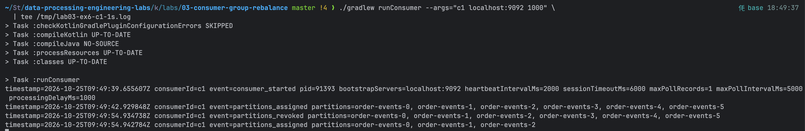

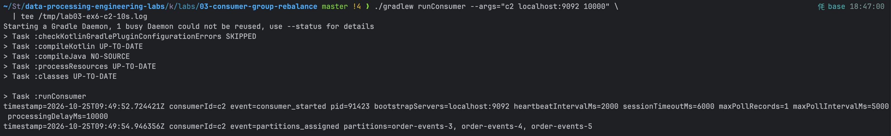

두 컨슈머의 최초 할당이 끝난 뒤 그룹은 `Stable`, 멤버 수는 2였다. c1은 파티션 0, 1, 2를, c2는 파티션 3, 4, 5를 소유했다.

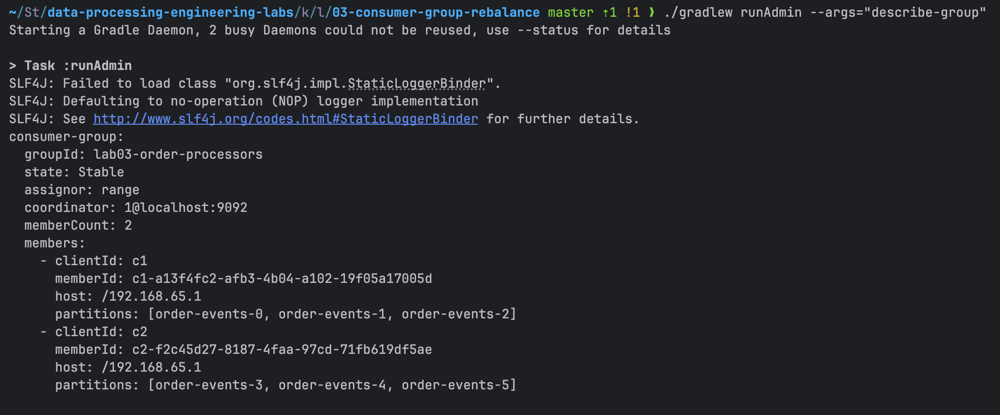

#### 2. c2의 Poll Timeout과 재가입

c2는 한 건을 처리하는 데 10초가 걸려 Max Poll Interval 5초 안에 다음 `poll()`을 호출하지 못했다. 처리를 마친 c2가 다시 `poll()` 경로로 돌아오면 파티션 반납과 재가입이 이어졌고, 약 2초 뒤 파티션 3, 4, 5를 다시 할당받았다.

```text
processedDate=2026-10-25T09:51:38.545974Z processingDelayMs=10000 consumerId=c2 partition=4 offset=0 ...
timestamp=2026-10-25T09:51:38.547547Z consumerId=c2 event=partitions_revoked partitions=order-events-3, order-events-4, order-events-5
timestamp=2026-10-25T09:51:40.611181Z consumerId=c2 event=partitions_assigned partitions=order-events-3, order-events-4, order-events-5
processedDate=2026-10-25T09:51:50.622572Z processingDelayMs=10000 consumerId=c2 partition=3 offset=0 ...
timestamp=2026-10-25T09:51:50.623635Z consumerId=c2 event=partitions_revoked partitions=order-events-3, order-events-4, order-events-5
timestamp=2026-10-25T09:51:52.725735Z consumerId=c2 event=partitions_assigned partitions=order-events-3, order-events-4, order-events-5
```


#### 3. c1까지 영향을 받은 반복 리밸런싱

c2가 그룹에서 빠질 때 c1은 6개 파티션을 모두 할당받았다. c2가 재가입하면 c1은 6개를 반납하고 파티션 0, 1, 2를 다시 할당받았다. 이 변화는 실험이 끝날 때까지 반복됐다.

```text
timestamp=2026-10-25T09:51:23.486896Z consumerId=c1 event=partitions_revoked partitions=order-events-0, order-events-1, order-events-2
timestamp=2026-10-25T09:51:23.494249Z consumerId=c1 event=partitions_assigned partitions=order-events-0, order-events-1, order-events-2, order-events-3, order-events-4, order-events-5
timestamp=2026-10-25T09:51:28.525815Z consumerId=c1 event=partitions_revoked partitions=order-events-0, order-events-1, order-events-2, order-events-3, order-events-4, order-events-5
timestamp=2026-10-25T09:51:28.532534Z consumerId=c1 event=partitions_assigned partitions=order-events-0, order-events-1, order-events-2
```


#### 4. 로그 집계

로그 전체에서 `processedDate`와 `partitions_revoked`를 센 결과는 다음과 같았다.

```text
c1 레코드 출력:       221
c2 레코드 출력:        30
c1 파티션 반납 콜백:    61
c2 파티션 반납 콜백:    30
```


### 결과

| 컨슈머 | 처리 지연 | Max Poll Interval | 레코드 출력 수 | 파티션 반납 콜백 수 | 파티션 할당 변화 | 프로세스 종료 |
|---|---:|---:|---:|---:|---|---|
| c1 | 1초 | 5초 | 221 | 61 | 3개 ↔ 6개 반복 | 없음 |
| c2 | 10초 | 5초 | 30 | 30 | 반납 후 3개 재할당 반복 | 없음 |

파티션 반납 콜백 수는 다음과 같이 해석했다.

| 관찰값 | 의미 |
|---|---|
| c2 30회 | 10초 처리로 Poll Timeout이 반복된 주기 수 |
| c1 최초 1회 | c2가 처음 그룹에 합류할 때 발생한 파티션 반납 |
| c1 추가 60회 | c2의 30회 이탈과 30회 재가입으로 발생한 파티션 반납 |

`processedDate`는 애플리케이션이 레코드 내용을 출력한 횟수이지, 고유 레코드 수나 Offset Commit 완료 건수가 아니다. `partition:offset`을 기준으로 다시 집계한 결과는 다음과 같았다.

| 컨슈머 | 레코드 출력 수 | 고유 `partition:offset` 수 | 같은 컨슈머 내부의 중복 출력 수 |
|---|---:|---:|---:|
| c1 | 221 | 221 | 0 |
| c2 | 30 | 22 | 8 |

c2가 출력한 고유 `partition:offset` 22개는 모두 c1 로그에도 나타났다. c1 로그에서는 각 파티션의 최초 offset부터 마지막으로 관찰한 offset까지 중간 누락이 없었지만, Producer 발행 총량과 Commit 성공 여부를 함께 기록하지 않았으므로 전체 레코드의 무손실까지 증명한 것은 아니다.

### 해석 및 궁금증

#### 세 설정이 확인하는 상태

| 설정 | 확인 기준 | 이번 실험에서의 역할 |
|---|---|---|
| `heartbeat.interval.ms` | 컨슈머가 Heartbeat를 보내는 주기 | 2초 |
| `session.timeout.ms` | 브로커가 마지막 Heartbeat 이후 기다리는 시간 | 6초 |
| `max.poll.interval.ms` | 컨슈머에서 연속된 `poll()` 호출 사이에 허용되는 최대 시간 | 5초 |

`max.poll.interval.ms`의 기준은 Offset Commit 완료가 아니라 다음 `poll()` 호출이다. 레코드 처리나 `commitSync()` 같은 작업이 다음 호출을 늦추면 그 시간도 Poll Interval을 소비하지만, Commit 성공 자체가 Poll 타이머를 갱신하지는 않는다.

#### Poll Timeout 감지와 리밸런싱의 주체

브로커는 애플리케이션이 `poll()`을 호출했는지 직접 알 수 없다. 이번 실험의 Dynamic Member에서는 컨슈머 클라이언트가 Poll Timeout을 감지하고 그룹을 떠나며, 브로커의 Group Coordinator가 실제 멤버 관리와 파티션 재할당을 수행한다.

```text
c2 poll()에서 레코드 1건 반환
    ↓
c2가 10초 동안 처리
    ↓ 5초 경과
c2 클라이언트가 Poll Timeout 감지 후 LeaveGroup 요청
    ↓
브로커가 c2를 제외하고 c1에 파티션 6개 할당
    ↓ 10초 처리 종료
c2가 다음 poll()을 호출하며 그룹에 재가입
    ↓
브로커가 c1과 c2에 파티션을 3개씩 다시 할당
```

Experiment 5의 프로세스 강제 종료나 Network 단절처럼 `LeaveGroup` 요청을 보낼 수 없는 상황에서는 이 경로를 사용할 수 없다. 이때는 브로커가 Heartbeat 부재를 `session.timeout.ms`로 판단해 멤버를 제거한다.

#### 애플리케이션 생존과 정상 처리의 차이

- c2 프로세스와 Heartbeat Thread가 실행 중이어도 다음 `poll()`이 늦으면 그룹에서 빠질 수 있다.
- c2 하나의 느린 처리로 정상 처리 중인 c1도 파티션을 계속 반납하고 재할당받았다.
- c2가 같은 offset을 반복 출력했으므로 레코드 출력, 처리 완료와 Offset Commit 성공을 같은 의미로 볼 수 없다.
- 미처리 예외나 프로세스 종료는 관찰되지 않았다. 프로세스가 실행 중이라는 사실만으로 컨슈머 그룹과 레코드 처리가 정상이라고 판단할 수 없다.

#### 설정 변경으로 해결할 때의 한계

- `max.poll.interval.ms`를 레코드 처리, Commit과 부가 작업의 최악 시간보다 충분히 크게 설정하면 Poll Timeout을 피할 수 있다. 그러나 값을 지나치게 늘리면 실제로 멈춘 컨슈머를 감지하고 파티션을 넘기는 시간도 길어진다.
- `max.poll.records=1`은 한 번에 반환되는 레코드 수를 줄였지만, 한 건의 처리 시간 10초가 Max Poll Interval 5초보다 길었기 때문에 문제를 해결하지 못했다.
- 처리 시간의 편차가 큰 환경에서는 Poll과 실제 처리를 분리하는 구조가 필요할 수 있다. Offset Commit, 파티션별 순서와 진행 중인 작업 처리는 후속 실험에서 별도로 확인한다.

#### 측정 한계와 남은 질문

| 항목 | 한계 또는 다음 확인 사항 |
|---|---|
| 처리량 비교 | 두 컨슈머의 첫 레코드 출력 시각이 약 9초 다르고 중복 offset도 있어, 221대 30을 정확한 초당 처리량이나 고유 처리 건수로 비교할 수 없다. |
| 리밸런싱 횟수 | 표의 값은 그룹 전체 리밸런싱 횟수가 아니라 각 컨슈머에서 실행된 `partitions_revoked` 콜백 횟수다. |
| Commit 결과 | 현재 로그에는 Offset Commit 성공과 실패가 기록되지 않아 중복 처리의 정확한 Commit 경계를 확인하지 못했다. |
| 반복성 | 한 번의 실행 결과이므로 처리 지연과 리밸런싱 횟수의 분포는 확인하지 않았다. |

## Experiment 7. Compare Partition Assignors

### 목적

- Range, RoundRobin, Sticky와 CooperativeSticky Assignor의 파티션 분배를 비교한다.
- 컨슈머가 1명에서 2명, 3명으로 늘고 c2가 이탈할 때 파티션 소유자가 얼마나 바뀌는지 확인한다.
- Eager Rebalance와 Cooperative Rebalance에서 기존 컨슈머가 반납하는 파티션 범위를 비교한다.

### 명령어

컨슈머 실행 인자는 다음 순서로 받도록 확장했다. Assignor를 지정하지 않으면 기존 설정을 사용하고, 지정할 때는 `range`, `roundrobin`, `sticky`, `cooperative-sticky` 중 하나를 사용한다.

```text
<consumer-id> [bootstrap-servers] [processing-delay-ms] [group-id] [assignor]
```

코드가 컴파일되는지 확인하고, 6개 파티션의 토픽과 지속 프로듀서를 준비했다. 네 Assignor의 실행이 끝날 때까지 같은 토픽과 프로듀서를 유지하되, 이전 실행의 그룹 상태가 섞이지 않도록 Assignor마다 다른 `group.id`를 사용했다.

```bash
./gradlew compileKotlin
docker compose config --quiet

docker compose up -d
./gradlew runAdmin --args="create-topic 6"
./gradlew --quiet runProducer --args="continuous"
```

각 Assignor에서 같은 순서를 반복했다.

1. c1을 실행한다.
2. c2를 실행한 뒤 멤버가 2명인 할당을 저장한다.
3. c3를 실행한 뒤 멤버가 3명인 할당을 저장한다.
4. c2를 정상 종료하고 c1과 c3의 재할당 결과를 저장한다.
5. 세 컨슈머 로그에서 `partitions_revoked`, `partitions_assigned` 콜백만 모은다.

Range의 실행 명령은 다음과 같다. Range에서는 c2에 `SIGTERM`을 보냈고, 나머지 세 Assignor에서는 c2 터미널에서 `Ctrl+C`로 종료했다. 두 방식 모두 Shutdown Hook을 거쳐 `consumer.close()`를 호출하는 정상 종료 경로다.

```bash
# Terminal 1
./gradlew --quiet runConsumer \
  --args="c1 localhost:9092 0 lab03-ex7-range range" \
  | tee /tmp/lab03-ex7-range-c1.log

# Terminal 2
./gradlew --quiet runConsumer \
  --args="c2 localhost:9092 0 lab03-ex7-range range" \
  | tee /tmp/lab03-ex7-range-c2.log

# 멤버 2명
./gradlew --quiet runAdmin \
  --args="describe-group lab03-ex7-range" \
  | tee /tmp/lab03-ex7-range-2-members.log

# Terminal 3
./gradlew --quiet runConsumer \
  --args="c3 localhost:9092 0 lab03-ex7-range range" \
  | tee /tmp/lab03-ex7-range-c3.log

# 멤버 3명
./gradlew --quiet runAdmin \
  --args="describe-group lab03-ex7-range" \
  | tee /tmp/lab03-ex7-range-3-members.log

# c2의 consumer_started 로그에서 확인한 PID에 SIGTERM을 전송한다.
kill -TERM <c2-pid>

# c2 종료 후
./gradlew --quiet runAdmin \
  --args="describe-group lab03-ex7-range" \
  | tee /tmp/lab03-ex7-range-after-c2-exit.log

grep -E 'event=partitions_(revoked|assigned)' \
  /tmp/lab03-ex7-range-c1.log \
  /tmp/lab03-ex7-range-c2.log \
  /tmp/lab03-ex7-range-c3.log \
  | tee /tmp/lab03-ex7-range-rebalance-events.log
```

나머지 Assignor도 위 명령의 Assignor 이름, Group ID와 로그 접두사만 다음과 같이 바꿔 실행했다.

| Assignor 인자 | Group ID | 로그 접두사 |
|---|---|---|
| `roundrobin` | `lab03-ex7-roundrobin` | `/tmp/lab03-ex7-roundrobin` |
| `sticky` | `lab03-ex7-sticky` | `/tmp/lab03-ex7-sticky` |
| `cooperative-sticky` | `lab03-ex7-cooperative-sticky` | `/tmp/lab03-ex7-cooperative-sticky` |

`grep` 결과는 컨슈머별 파일 순서로 출력되므로 한 화면에서 위아래 순서만 보고 이벤트 발생 순서를 판단하지 않았다. 서로 다른 컨슈머의 이벤트는 각 줄의 `timestamp`를 함께 비교했다.

### 실제 출력

#### 1. Range

c1만 있을 때는 6개 파티션을 모두 소유했다. c2 합류 후에는 연속된 파티션을 3개씩, c3 합류 후에는 2개씩 소유했다. c2가 이탈하자 c1은 0, 1, 2를, c3는 3, 4, 5를 소유했다.


#### 2. RoundRobin

컨슈머가 2명일 때 c1은 짝수 파티션, c2는 홀수 파티션을 소유했다. 3명이 되거나 c2가 이탈한 뒤에도 파티션 번호를 컨슈머 순서대로 번갈아 배분했다.


#### 3. Sticky

각 단계의 파티션 수는 균등하게 유지하면서, 직전 할당을 가능한 한 보존했다. c2가 이탈한 뒤에도 c1의 0, 1과 c3의 2, 5는 그대로 유지됐다.


#### 4. CooperativeSticky

Stable 상태의 최종 할당은 Sticky와 같았다. 차이는 할당 결과가 아니라 콜백 과정에서 나타났다. c2가 합류할 때 c1은 넘겨줄 3, 4, 5만 반납했고, c3가 합류할 때도 c1은 2, c2는 5만 반납했다.


### 결과

#### 파티션 할당 변화

표의 숫자는 파티션 번호다.

| Assignor | 컨슈머 1명 | 컨슈머 2명 | 컨슈머 3명 | c2 종료 후 |
|---|---|---|---|---|
| Range | c1: 0–5 | c1: 0,1,2<br>c2: 3,4,5 | c1: 0,1<br>c2: 2,3<br>c3: 4,5 | c1: 0,1,2<br>c3: 3,4,5 |
| RoundRobin | c1: 0–5 | c1: 0,2,4<br>c2: 1,3,5 | c1: 0,3<br>c2: 1,4<br>c3: 2,5 | c1: 0,2,4<br>c3: 1,3,5 |
| Sticky | c1: 0–5 | c1: 0,1,2<br>c2: 3,4,5 | c1: 0,1<br>c2: 3,4<br>c3: 2,5 | c1: 0,1,3<br>c3: 2,4,5 |
| CooperativeSticky | c1: 0–5 | c1: 0,1,2<br>c2: 3,4,5 | c1: 0,1<br>c2: 3,4<br>c3: 2,5 | c1: 0,1,3<br>c3: 2,4,5 |

#### 파티션 이동량과 반납 범위

`이동 수`는 앞 단계와 다음 Stable 상태에서 소유자가 달라진 파티션의 수다. `기존 컨슈머의 반납 수`는 리밸런싱에 계속 참여하는 컨슈머의 `partitions_revoked`에 나타난 파티션 수의 합이다. c2 종료 단계에서는 종료 중인 c2가 반납한 2개를 제외해, 계속 실행 중인 c1과 c3가 작업을 멈춰야 하는 범위만 비교했다.

| Assignor | 이동 수<br>1→2 / 2→3 / c2 종료 | 기존 컨슈머의 반납 수<br>1→2 / 2→3 / c2 종료 | 관찰한 특징 |
|---|---:|---:|---|
| Range | 3 / 3 / 2 | 6 / 6 / 4 | 연속 구간을 다시 만들면서 2→3에서 최소량보다 1개 더 이동했다. |
| RoundRobin | 3 / 4 / 4 | 6 / 6 / 4 | 매 단계 균등했지만 번호를 번갈아 배치하면서 이동이 가장 많았다. |
| Sticky | 3 / 2 / 2 | 6 / 6 / 4 | 이동량은 최소였지만 Eager 방식이므로 기존 할당을 모두 반납했다. |
| CooperativeSticky | 3 / 2 / 2 | 3 / 2 / 0 | Sticky와 같은 최종 할당을 만들면서 실제로 넘길 파티션만 반납했다. |

정상 종료한 c2 자체에서는 네 Assignor 모두 자신이 소유하던 2개 파티션의 반납 콜백이 실행됐다. 이 값까지 포함하면 c2 종료 단계의 전체 반납 수는 Range, RoundRobin, Sticky가 각각 6개이고 CooperativeSticky는 2개다.

`반납 수`와 `이동 수`는 서로 다른 비용을 나타낸다.

| 관찰값 | 나타내는 비용 | 값이 클 때 발생할 수 있는 일 |
|---|---|---|
| 반납 수 | 리밸런싱 중 처리를 멈추는 범위 | 일시적인 처리량 감소와 Consumer Lag 증가 |
| 이동 수 | 리밸런싱 후 소유자가 실제로 바뀌는 범위 | 파티션별 상태 저장·전달, 캐시 재구축, Offset과 외부 리소스 초기화 증가 |

예를 들어 Sticky의 2→3 단계에서는 기존 컨슈머가 6개를 모두 반납했지만 실제로 새 컨슈머에게 이동한 파티션은 2와 5뿐이었다. 즉 Eager Rebalance로 인한 전체 중단 범위는 줄이지 못했지만, 새 소유자에게 작업 상태를 인계하고 초기화해야 하는 범위는 최소화했다.

#### 레코드 출력 중단 관찰

이번 실행에서는 모든 레코드를 한 로그로 시간순 병합해 리밸런싱 전후의 출력 간격을 측정하는 명령을 별도로 수행하지 않았다. 따라서 Assignor별 정확한 처리 중단 시간을 숫자로 결론 내리지는 않았다.

다만 CooperativeSticky의 합류 과정에서는 콜백이 두 단계로 약 2초간 이어지는 동안에도, 반납하지 않은 파티션의 레코드가 계속 출력됐다. 반면 Range, RoundRobin과 Sticky는 합류 시 기존 컨슈머의 파티션을 모두 반납했다. 이 로그로 확인한 차이는 `리밸런싱에 걸린 총시간`보다 `리밸런싱 중 계속 처리할 수 있는 파티션의 범위`다.

### 해석 및 궁금증

#### Range와 RoundRobin은 모두 균등하지만 할당 모양이 다르다

토픽이 하나이고 파티션 6개가 컨슈머 수로 나누어떨어져서 두 Assignor 모두 파티션 개수는 `3:3`, `2:2:2`, `3:3`으로 균등했다. 그러나 Range는 토픽 안에서 연속 구간을 주고, RoundRobin은 파티션을 컨슈머 순서대로 번갈아 줬다.

따라서 최종 파티션 개수만 보면 차이가 작아 보이지만, 기존 소유자까지 비교하면 차이가 드러난다. 2명에서 3명으로 늘 때 Range는 3개, RoundRobin은 4개가 이동했다. 이 실험은 토픽 하나에서의 결과이며, 여러 토픽과 서로 다른 파티션 수를 사용하면 균등성도 달라질 수 있다.

#### 균등 분배와 최소 이동은 별개의 목표다

네 Assignor 모두 각 단계에서 파티션 수를 균등하게 만들었다. 하지만 같은 균등 상태를 만드는 데 필요한 이동량은 달랐다.

- 1명에서 2명으로 늘 때 새 컨슈머가 3개를 받아야 하므로 최소 이동량은 3개다.
- 2명에서 3명으로 늘 때 새 컨슈머가 2개를 받아야 하므로 최소 이동량은 2개다.
- 3명 중 1명이 빠질 때 그 컨슈머의 2개를 다른 컨슈머가 받아야 하므로 최소 이동량은 2개다.

Sticky와 CooperativeSticky는 `3 / 2 / 2`로 세 단계 모두 최소 이동량을 달성했다. Range와 RoundRobin은 균등한 결과를 만들었지만 일부 단계에서 이미 할당된 파티션까지 추가로 이동했다.

#### Sticky와 CooperativeSticky의 차이는 최종 할당보다 전환 과정이다

이번 실행에서 두 Assignor의 Stable 상태 할당과 이동량은 같았다. 그러나 Sticky는 Eager Rebalance를 사용하므로 기존 컨슈머가 현재 파티션을 모두 반납한 뒤 새 할당을 받았다. `sticky`는 직전 소유 관계를 가능한 한 유지하는 할당 계산 방식이지, 파티션을 부분적으로 반납하는 프로토콜을 뜻하지 않는다.

Sticky에서 최소 이동이 의미하는 것은 `전체 처리 중단 최소화`가 아니라 `리밸런싱 후 실제 소유권 변경 최소화`다.

```text
리밸런싱 전
c1: [0, 1, 2]
c2: [3, 4, 5]

Sticky 리밸런싱 후
c1: [0, 1]
c2: [3, 4]
c3: [2, 5]
```

c1과 c2는 Eager Rebalance 때문에 6개를 모두 반납하지만, 0, 1, 3, 4는 이전 소유자에게 다시 돌아간다. 실제 소유권이 바뀌는 것은 2와 5뿐이다.

이 차이는 파티션별 로컬 캐시, 집계 상태, 파일, 외부 시스템 연결처럼 소유자에 종속된 상태가 있을 때 중요하다. 같은 컨슈머가 다시 받은 파티션의 상태를 재사용하도록 구현하면 4개 파티션은 상태를 다른 프로세스로 전달하거나 처음부터 준비할 필요가 없다. 반대로 `onPartitionsRevoked()`에서 모든 상태를 즉시 제거하고 `onPartitionsAssigned()`에서 모두 다시 만든다면 Sticky의 최소 이동 장점을 충분히 활용하지 못한다. 이전 할당을 기억한 뒤 새 할당과 비교해 실제로 잃은 파티션만 정리하는 방식이 필요하다.

현재 실험처럼 레코드를 출력하기만 하고 파티션별 상태를 유지하지 않는 컨슈머에서는 Eager Sticky의 실무 효과가 작게 보일 수 있다. 상태 저장 처리에서는 이동 수가 많을수록 상태 복원 시간, 원격 저장소 접근량과 캐시가 비어 있는 시간이 늘 수 있다.

CooperativeSticky는 넘겨야 할 파티션만 먼저 반납하고 나머지는 계속 소유했다. c3 합류 시 다음과 같이 c1과 c2가 한 개씩만 넘긴 것이 대표적이다.

```text
c1: revoked [2], retained [0, 1]
c2: revoked [5], retained [3, 4]
c3: assigned [2, 5]
```

따라서 CooperativeSticky는 서로 다른 두 비용을 함께 줄인다.

- Sticky 할당 계산으로 실제 소유자가 바뀌는 파티션 수를 줄인다.
- Cooperative Rebalance로 소유자가 바뀌지 않는 파티션을 반납하지 않고 계속 처리한다.

#### 파티션 이동은 중복이나 유실을 뜻하지 않는다

파티션 이동은 Offset과 처리 상태를 인계해야 하는 경계를 만든다. 하지만 파티션이 하나라도 이동했다고 해서 반드시 중복이나 유실이 발생하는 것은 아니다. 정상적인 리밸런싱에서는 이전 소유자가 파티션을 반납한 다음 새 소유자가 할당받는다.

처리 완료와 Offset Commit의 순서에 따라 결과가 달라진다. 아래의 Offset 101은 다음에 처리할 레코드를 뜻한다.

| 리밸런싱 직전 상태 | 새 소유자의 시작 위치 | 결과 |
|---|---|---|
| 레코드 100 처리 완료 → Offset 101 Commit 성공 | 101 | 중복과 유실 없음 |
| 레코드 100 처리 완료 → 외부 반영 완료 → Commit 전 이동 | 마지막 Commit 위치인 100 | 레코드 100 중복 처리 가능 |
| Offset 101 Commit → 레코드 100 외부 반영 실패 → 이동 | 101 | 애플리케이션 관점의 유실 가능 |

따라서 최소 이동은 중복·유실을 보장하는 기능이 아니라, 이런 인계 경계에 놓이는 파티션 수와 상태 이전 비용을 줄이는 기능이다. 중복과 유실은 Offset Commit과 실제 처리 결과를 어떤 순서와 원자성으로 관리하는지에 달려 있다.

`onPartitionsRevoked()`는 정상적인 소유권 이전 전에 처리 완료 Offset과 파티션 상태를 저장할 기회를 제공한다. 하지만 프로세스 강제 종료나 Session Timeout처럼 이전 소유자가 콜백을 실행하지 못하는 경우도 있으므로, 실무에서는 다음 대책을 함께 고려해야 한다.

- 처리 완료 후 Offset을 Commit해 기본적으로 At-least-once를 유지한다.
- 중복 실행되어도 결과가 달라지지 않도록 멱등성을 확보한다.
- Kafka 입출력을 함께 묶을 수 있다면 Transaction과 `read_committed`를 검토한다.
- DB 같은 외부 시스템과 함께 처리하면 고유 이벤트 ID, Unique Constraint 또는 처리 이력으로 중복을 방어한다.

이번 코드의 `RebalanceLoggingListener`는 콜백을 출력할 뿐 Offset을 직접 Commit하거나 파티션 상태를 저장하지 않는다. 컨슈머도 `enable.auto.commit`을 명시하지 않아 Kafka Client 기본값인 Auto Commit을 사용한다. 따라서 이번 캡처로 확인한 것은 반납 및 할당 범위이며, 중복·유실이나 처리 결과의 원자성은 검증하지 않았다.

#### CooperativeSticky의 빈 Assigned 콜백

CooperativeSticky 로그에는 `partitions_assigned partitions=`처럼 빈 할당 콜백이 나타났다. 첫 단계에서 기존 컨슈머는 넘길 파티션만 반납하고, 유지하는 파티션은 이미 소유 중이므로 새로 할당할 목록이 없을 수 있다. 이후 소유권 이전이 끝난 다음 단계에서 새 컨슈머가 해당 파티션을 받는다. 빈 목록은 컨슈머가 모든 파티션을 잃었다는 뜻이 아니다.

#### Cooperative Rebalance도 중단을 완전히 제거하지는 않는다

Cooperative Rebalance는 모든 기존 컨슈머가 모든 파티션을 한꺼번에 반납하는 상황을 줄인다. 하지만 실제로 소유자가 바뀌는 파티션은 이전 컨슈머가 반납한 뒤 새 컨슈머가 할당받아야 하므로 그 파티션에는 전환 구간이 있다. Group Coordinator 통신, 콜백과 추가 리밸런싱 단계도 사라지지 않는다.

이번 로그에서 확인한 것은 `전체 파티션의 동시 중단을 피하고 유지한 파티션의 처리를 계속했다`는 점이다. 파티션별 정확한 중단 시간을 비교하려면 다음 실행에서 파티션별 마지막 처리 시각과 새 소유자의 최초 처리 시각을 별도로 계산해야 한다.

#### 같은 그룹에서 서로 다른 Assignor를 설정하면 어떻게 되는가

Assignor는 컨슈머마다 따로 실행되어 각자의 파티션을 결정하는 설정이 아니다. 같은 `group.id`의 멤버는 자신이 지원하는 Assignor 목록을 알리고, 그룹 전체가 공통으로 지원하는 Assignor 하나를 선택한다. 선택된 Assignor가 모든 멤버의 구독 정보를 사용해 그룹 전체의 파티션 할당을 계산한다.

현재 코드는 실행 인자로 받은 Assignor 하나만 `partition.assignment.strategy`에 등록한다. 따라서 같은 그룹에서 c1은 `range`, c2는 `sticky`로 실행하면 공통 Assignor가 없다.

```text
c1 지원 목록: [range]
c2 지원 목록: [sticky]
교집합:       []
결과:         InconsistentGroupProtocolException
```

이 경우 Range가 일부 파티션을 할당하고 Sticky가 나머지를 할당하는 식으로 두 전략이 섞이지 않는다. 새 멤버는 기존 그룹과 호환되는 프로토콜로 가입할 수 없고, 하나의 정상적인 그룹 할당을 만들 수 없다.

여러 Assignor를 선호도 순서대로 등록하면 공통 항목을 선택할 수 있다.

```text
c1: [cooperative-sticky, range]
c2: [range]
공통 Assignor: range

c1: [cooperative-sticky, range]
c2: [cooperative-sticky, range]
공통 우선 Assignor: cooperative-sticky
```

이 방식은 운영 중 Assignor를 바꿀 때 기존 버전과 새 버전이 공통 전략을 유지하도록 하는 Rolling Migration에 사용된다. 모든 멤버가 새 전략을 지원하도록 배포한 뒤 이전 전략을 목록에서 제거해 전환할 수 있다. 멤버별 목록이나 우선순위가 의도치 않게 다르면 예상과 다른 전략이 선택되거나 그룹 가입이 실패할 수 있으므로, 같은 Consumer Group의 설정은 배포 단위에서 일관되게 관리해야 한다.

이번 실험에서 Assignor마다 서로 다른 `group.id`를 사용한 이유도 전략을 혼합하기 위한 것이 아니라, 각 그룹이 하나의 Assignor만 사용하도록 분리해 결과와 Offset을 독립적으로 비교하기 위해서다.

#### 실무에서 구분할 선택 기준

| Assignor | 전체 파티션 동시 반납 | 실제 소유권 이동 | 실무적 의미 |
|---|---|---|---|
| Range | 발생 | 배치에 따라 증가 | 토픽별 연속 구간이라는 단순한 할당이 필요할 때 이해하기 쉽지만, 균형과 이동량은 구독 구조에 영향을 받는다. |
| RoundRobin | 발생 | 배치에 따라 증가 | 전체 파티션 수를 균등하게 나누기 쉽지만, 멤버 변화 때 기존 소유권을 많이 바꿀 수 있다. |
| Sticky | 발생 | 최소화 | 전체 중단은 허용되지만 파티션별 상태 이전과 재초기화 비용을 줄이고 싶을 때 의미가 있다. |
| CooperativeSticky | 이동 대상만 반납 | 최소화 | 이동하지 않는 파티션의 처리를 유지하면서 상태 이전 비용도 줄인다. |

결론적으로 Assignor를 비교할 때는 최종 파티션 개수만 확인해서는 부족하다. `얼마나 균등한가`, `몇 개의 소유자가 바뀌는가`, `리밸런싱 중 몇 개를 멈추는가`, `인계 시 Offset과 상태를 어떻게 안전하게 저장하는가`를 별도로 확인해야 한다.

## Troubleshooting

### `createTopics()`를 호출해도 중복 생성이 모두 성공한 것처럼 보임

- 증상: `admin.createTopics(listOf(newTopic))`만 호출했을 때 같은 명령을 반복해도 Gradle 실행이 성공으로 종료되었다.
- 원인: `createTopics()`는 비동기 결과인 `CreateTopicsResult`를 반환한다. 반환된 Future의 완료 결과를 확인하지 않아 Broker가 반환한 실패가 실행 스레드로 전파되지 않았다.
- 해결: `admin.createTopics(...).all().get()`으로 전체 Topic 생성 결과를 기다렸다.
- 확인: 첫 번째 생성은 성공했고, 같은 Topic을 다시 생성했을 때 `ExecutionException`의 원인으로 `TopicExistsException`이 출력되며 실행이 실패했다.
- 재발 방지: AdminClient의 변경 작업은 요청 전송 성공과 Broker 반영 성공을 구분하고, 완료 Future와 Topic별 오류를 반드시 확인한다.


### SLF4J Logger Binder 경고

- 증상: AdminClient 실행마다 `Failed to load class org.slf4j.impl.StaticLoggerBinder`와 NOP Logger 경고가 출력되었다.
- 원인: Kafka Client가 사용하는 SLF4J API에 대응하는 Logging 구현체를 현재 Lab의 Runtime Dependency로 추가하지 않았다.
- 영향: Kafka Admin 요청과 Topic/Consumer Group 조회 자체는 정상적으로 완료되었지만 Kafka Client 내부 로그는 출력되지 않는다.
- 대응: Experiment 1에서는 경고와 기능 실패를 구분해 기록하고, 현재 실험에 필요하지 않은 Logging Dependency는 미리 추가하지 않는다.
- 재발 방지: 이후 Kafka Client 내부 로그가 실제 관찰 대상이 되는 Experiment에서 SLF4J API 버전과 호환되는 구현체를 명시적으로 선택한다.

### Experiment 4의 SIGTERM 실행에서 정상 종료 로그 없이 세션 타임아웃 뒤 재할당됨

- 증상: `kill -TERM` 이후 c2의 종료 요청과 `consumer.close()` 로그가 없었고, c1은 약 45초 뒤 파티션을 재할당받았다.
- 원인: Experiment 4의 첫 번째 실행에서 `ps -ef | grep c2`에 표시된 Gradle Wrapper PID를 종료했다. 실제 c2는 Gradle이 실행한 별도의 `OrderEventConsumerKt c2` JVM이었다.
- 해결: 컨슈머가 시작할 때 자신의 PID를 출력하도록 하고 그 PID에 SIGTERM을 보낸다. SIGTERM 수신 시 `poll()`을 중단하고 컨슈머 실행 스레드에서 `consumer.close()`를 호출하는 종료 처리도 먼저 구현한다.
- 재발 방지: 종료 전에 PID의 명령이 `lab.kafka.OrderEventConsumerKt c2`인지 확인하며, Gradle Wrapper나 Gradle Daemon PID를 사용하지 않는다.

### Experiment 5에서 Network 단절이 c2에만 적용되지 않는 문제

- 증상: Toxiproxy를 비활성화해도 c2가 계속 레코드를 처리하거나, 반대로 c1과 다른 클라이언트까지 Kafka 연결이 끊긴다.
- 원인: c2가 `localhost:9092`에 직접 연결했거나, Kafka가 광고한 `PROXY` 주소가 Toxiproxy를 우회하도록 설정됐거나, Proxy의 `upstream`이 컨테이너 내부의 잘못된 주소를 가리켰다. Kafka 컨테이너나 공통 Docker Network를 중단한 경우에도 모든 클라이언트가 함께 영향을 받는다.
- 해결: c1, Producer와 AdminClient는 `localhost:9092`의 `DIRECT` listener를 사용하고, c2만 `localhost:29092`의 Toxiproxy를 사용한다. Kafka의 광고 주소는 `PROXY://localhost:29092`, Proxy의 `upstream`은 Compose service 이름을 사용한 `kafka:29093`으로 설정한다.
- 확인: c1 시작 로그의 `bootstrapServers`는 `localhost:9092`, c2는 `localhost:29092`인지 확인한다. Proxy 비활성화 후에는 c2 프로세스가 살아 있지만 c1이 6개 파티션을 다시 할당받아야 하며, Proxy 복구 후에는 c2가 그룹에 재가입해야 한다.
- 재발 방지: Toxiproxy 제어 API `8474`와 c2 접속 Port `29092`는 `127.0.0.1`에만 bind한다. `depends_on`은 시작 순서만 보장하므로 Topic 생성이 실패하면 `docker compose ps`와 `docker compose logs kafka`로 Kafka 준비 상태를 확인한다.
